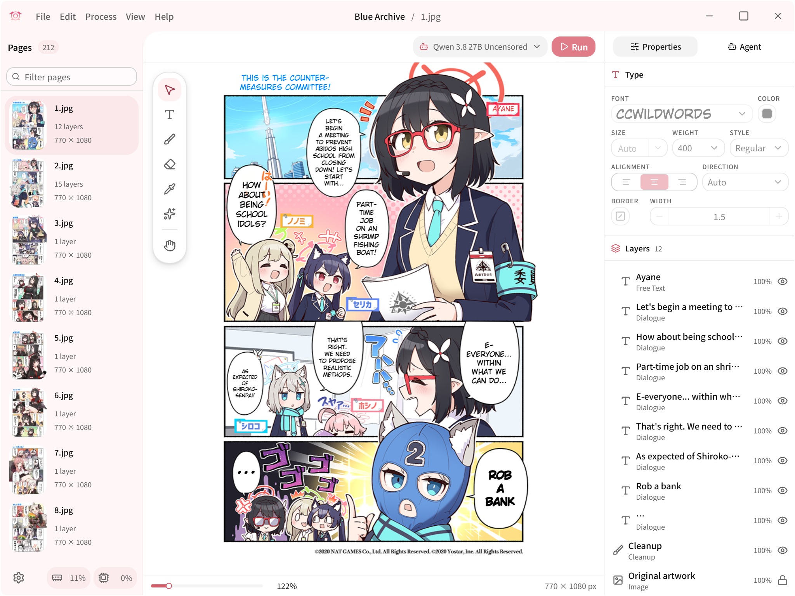
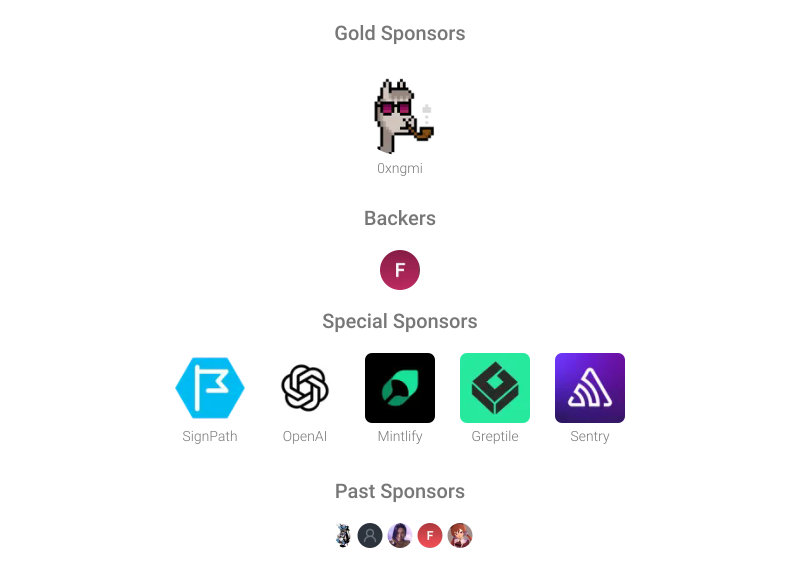

<h1 align="center">Koharu + Rawkuma</h1>

<p align="center">ML-powered manga translator, written in <b>Rust</b>.</p>

Fork của [koharu-rs/koharu](https://github.com/koharu-rs/koharu), bổ sung duyệt và dịch chương truyện từ Rawkuma ngay trong ứng dụng desktop. Mã nguồn fork: [flowerfx/koharu](https://github.com/flowerfx/koharu).

## Tính năng bổ sung của fork

| Tính năng                     | Hỗ trợ                                                                                                                                                                                                                   |
| ----------------------------- | ------------------------------------------------------------------------------------------------------------------------------------------------------------------------------------------------------------------------ |
| Trình duyệt Rawkuma trong app | Nút **Rawkuma** mở website; dùng danh sách truyện, tìm kiếm, thể loại và danh sách chương của website. Có Back, Forward, Reload, Home và ô nhập URL.                                                                     |
| Dịch chương hiện tại          | **Translate this chapter** lấy danh sách ảnh từ tài liệu đang mở, tải theo đúng thứ tự, tạo project và chạy pipeline detection → OCR → translation / inpainting có sẵn của Koharu.                                       |
| Nhiều ngôn ngữ đích           | Chọn trực tiếp trong màn hình Rawkuma, dùng lại danh sách 43 ngôn ngữ của Koharu: Việt, Anh, Nhật, Hàn, Trung, Pháp, Đức, Tây Ban Nha, Ả Rập… Khả năng và chất lượng thực tế phụ thuộc model/provider đã chọn.           |
| Model dịch hiện có            | Giữ cấu hình model/provider của người dùng, bao gồm Qwen 3.8 27B GGUF và các mức lượng tử hóa có trong danh mục. Fork không yêu cầu một dịch vụ dịch riêng.                                                              |
| Cache ảnh                     | Lưu nội dung ảnh theo BLAKE3; kiểm tra lại tính toàn vẹn trước khi dùng cache. **Check source updates** dùng ETag hoặc Last-Modified để gửi yêu cầu có điều kiện và tận dụng phản hồi HTTP 304.                          |
| Dùng lại kết quả dịch         | Chỉ bỏ qua suy luận khi project đã dịch thành công, revision còn khớp và ảnh/cấu hình dịch không đổi. Khóa cache bao gồm URL chương, thứ tự/nội dung ảnh, ngôn ngữ, model và các cấu hình pipeline/typesetting/provider. |
| Giữ bản trước                 | **Translate a new copy** tạo project mới để giữ project cũ. Ảnh nguồn thay đổi hoặc cấu hình dịch khác cũng có khóa cache riêng.                                                                                         |
| Xóa cache                     | **Clear cache** xóa ảnh tải xuống, HTTP metadata và chỉ mục cache. Project `.khrproj` đã lưu và phiên trình duyệt được giữ lại.                                                                                          |
| Bảo vệ editor                 | Trang nguồn không được gọi các command của editor; URL tải ảnh và redirect bị giới hạn ở CDN Rawkuma.                                                                                                                    |

### Cách dùng

1. Mở **Settings** để chọn model dịch, OCR và inpainting phù hợp. Có thể dùng Qwen 3.8 27B Q4 nếu máy đủ bộ nhớ; lần đầu app cần tải các mô hình chưa có.
2. Bấm **Rawkuma** ở thanh tiêu đề, tìm truyện và mở chương muốn đọc. Cũng có thể dán URL chương vào ô địa chỉ rồi bấm **Go**.
3. Chọn **Target language**. Đây là ngôn ngữ của bản dịch, độc lập với ngôn ngữ giao diện app.
4. Giữ **Check source updates** bật nếu muốn kiểm tra ảnh mới từ máy chủ. Bật **Translate a new copy** nếu muốn dịch lại và giữ project trước đó.
5. Bấm **Translate this chapter**. App hiển thị tiến độ tải ảnh, chuyển sang editor và chạy xử lý cho toàn project. Dùng cơ chế Stop, sửa nội dung, lưu và export có sẵn của Koharu.

App lấy danh sách ảnh từ trang thực tế thay vì đoán URL `chapter/page.jpg`, vì slug, số chương thập phân, định dạng và số lượng ảnh có thể khác nhau. Bộ trích ảnh nhận đường dẫn bất kỳ trên đúng host `cdn.rawkuma.com`, ví dụ `/s/...`, `/images/...` hoặc `/w/.../38.5/1.webp`; chỉ chọn ảnh trong vùng đọc truyện hoặc ảnh có nhãn trang, rồi kiểm tra nội dung JPEG/PNG/WebP khi tải về. Hiện giới hạn tối đa 500 ảnh/chương và 32 MiB/ảnh; hỗ trợ JPEG, PNG và WebP theo nội dung ảnh thực tế.

### Phạm vi và trạng thái kiểm chứng

- Đã build và chạy bản macOS Apple Silicon độc lập; nhập thực tế 32 trang của một chương Rawkuma và hiển thị trong editor.
- Đã xác minh tải ảnh với User-Agent riêng `Koharu/<version>` và phản hồi HTTP 304 với ETag/Last-Modified. Trong lần kiểm tra này, User-Agent mặc định của Python bị CDN từ chối bằng HTTP 403; không cần sao chép cookie Chrome.
- 10 kiểm tra backend và 13 kiểm tra component đã qua; frontend build, kiểm tra kiểu và định dạng đã qua.
- Đã hoàn tất lượt dịch lại 28 trang có OCR sẵn trên Mac qua LM Studio trên Windows, với Qwen 3.8 27B Q4 và đích tiếng Việt; bản dịch trả về và hiển thị trực tiếp trong editor. Chưa đánh giá thủ công độ chính xác của toàn chương hoặc benchmark tốc độ. Chưa kiểm chứng app Rawkuma chạy trực tiếp trên Windows/Linux.
- Có thêm app SwiftUI riêng cho iPad/iPhone trong [`apps/ipad`](apps/ipad/README.md): duyệt Rawkuma, thư viện chương, chọn bốn model OCR và bốn model inpaint chạy ngay trên iPad, dịch qua LM Studio hoặc GGUF cục bộ bằng llama.cpp Metal, sửa văn bản và xuất PNG/PDF. App iPad không bao gồm toàn bộ editor/PSD của desktop. Xem phạm vi kiểm chứng và hướng dẫn ký/cài trong tài liệu iPad.
- Phần danh sách/tìm kiếm/thể loại dùng trực tiếp giao diện Rawkuma; chưa có thư viện truyện riêng, tải hàng loạt nhiều chương hay đồng bộ giữa thiết bị. Thay đổi cấu trúc website/CDN có thể cần cập nhật bộ trích ảnh.

### Build bản macOS debug của fork

Cài các phụ thuộc nền tảng trong phần **Development** bên dưới, cùng CMake/Ninja và target Rust `wasm32-unknown-unknown`. Chạy từ thư mục gốc repo:

```bash
bun install
rustup target add wasm32-unknown-unknown

# Tạo WASM cho canvas bằng profile dev.
CARGO_TARGET_DIR="$PWD/target/wasm-build" bun x wasm-pack@0.15.0 build \
  crates/koharu-canvas --dev --target web \
  --out-dir "$PWD/packages/bridge/src/wasm" --out-name koharu_canvas --no-pack

# Tạo frontend tĩnh rồi đóng gói app debug, không tạo gói auto-update.
SENTRY_AUTH_TOKEN= bun run --filter @koharu/app build
cargo tauri build --debug --bundles app \
  --config '{"build":{"beforeBuildCommand":""},"bundle":{"createUpdaterArtifacts":false}}'
```

Bundle macOS nằm tại `target/debug/bundle/macos/koharu.app`. Nếu libclang chưa được phát hiện, đặt `LIBCLANG_PATH` tới thư mục lib của LLVM/Xcode trên máy.

Project Rawkuma mới lưu URL chương gốc ngay trong tài liệu `.khrproj`. Nút **Original chapter** ở thanh trên mở đúng URL đó trong trình duyệt Rawkuma của app; từ đây bấm chương tiếp theo trên website rồi **Translate this chapter**. URL vẫn còn sau khi mở lại project hoặc Clear cache. Đã kiểm tra trên project 27.1 có 20 trang được mở lại từ cache và project 27.2 mới: nút nguồn điều hướng đúng URL đã lưu ngay cả khi browser đang ở trang chủ. Project cũ chưa lưu URL cần mở lại đúng chương trên Rawkuma và nhập/dịch chương đó để gắn URL; app không đoán link từ tên project.

## Bản iPad/iPhone

App native ở [`apps/ipad`](apps/ipad/README.md), hỗ trợ iOS/iPadOS 26 trở lên. Chọn **LM Studio** để dùng server trong LAN hoặc **On-device GGUF** để tải/import model và dịch trên thiết bị. Có đủ 12 ngôn ngữ giao diện theo lựa chọn trong Cài đặt (Anh US/UK, Pháp, Ả Rập, Tây Ban Nha, Bồ Đào Nha, Đức, Hàn, Nhật, Trung phồn thể/giản thể, Việt), bố cục phải sang trái cho tiếng Ả Rập và 43 ngôn ngữ dịch đích; OCR, render và cache nằm trên iPad. Trong **Cài đặt**, OCR có **Manga OCR, Baberu OCR, Hayai OCR v2.1, PaddleOCR VL 1.6** (vẫn giữ Apple Vision tích hợp). Xóa chữ nền có **LaMa Manga, AOT GAN, FLUX.2 Klein, RORem mixed**. Mỗi model tải riêng và xác minh SHA-256, có nút xóa để giải phóng bộ nhớ. Inpaint xử lý từng vùng ở độ phân giải gốc, giữ nguyên pixel ngoài mask; FLUX/RORem chạy Metal trực tiếp, cần nhiều RAM và thời gian hơn. App báo rõ khi RAM khả dụng không đủ; không tự đổi sang model khác. Xem dung lượng, runtime và giới hạn kiểm chứng trong [tài liệu iPad](apps/ipad/README.md).

Ở màn hình đọc, vuốt trái để sang trang tiếp, vuốt phải để về trang trước; khi phóng to, kéo để di chuyển ảnh. Màn hình đọc chặn vuốt quay lại của navigation để tránh kéo cả view; dùng nút Back để về thư viện. Model local được kiểm tra bộ nhớ trước khi nạp; chọn kích thước phù hợp RAM thực tế. Model 0.8B chỉ phù hợp kiểm tra runtime, chất lượng dịch có thể kém.

Trình duyệt nguồn dùng chung script điều hướng với Mac: Next/Prev mở URL thực, Home mở trang bộ truyện, dropdown dùng selector native từ danh sách chương của website, tự tải endpoint chương cùng origin nếu phần HTMX còn trống. Không suy đoán số chương kế tiếp hay giới hạn đường dẫn CDN vào một tiền tố.

Kiểm chứng: ba test DOM điều hướng đã qua. Trên bản Mac đã cài, Next/Prev chuyển đúng URL, Home về trang bộ truyện và dropdown chọn chương 33.2 nhận đúng 22 trang. Trên simulator iPad đã thử Next/Prev/Home và chọn chương thập phân từ dropdown, kiểm tra URL đích. Bản 0.1.1 đã ký Kuruby và cài trên iPad Pro M5 thật; làm mới model và dò server LM Studio trong LAN hoạt động. Runtime GGUF Metal và OCR chữ Nhật dọc đã qua kiểm tra tập trung trên iPad thật. Một chương 30 trang đã hoàn tất OCR mới, dịch qua LM Studio, xóa chữ nền LaMa và lưu đủ ảnh kết quả; chất lượng dịch vẫn phụ thuộc model. Xem số đo và giới hạn trong tài liệu iPad.

Bản iPad **0.3.1** hiển thị rõ tiến trình OCR → dịch → xóa nền (kèm model và số vùng) → lưu trang. Dịch toàn bộ project xử lý lần lượt từng trang; LM Studio chờ trong lúc FLUX/RORem xóa nền, nên một trang có nhiều vùng có thể mất nhiều phút. App giữ màn hình thức trong lúc chạy và vẫn giữ model bạn đã chọn.

Bản iPad **0.3.0** bổ sung **OpenAI, Anthropic, DeepSeek, Qwen, MiniMax, Gemini, Grok, OpenRouter và DeepL** trong **Cài đặt → Bản dịch → Nhà cung cấp**. Nhập API key riêng, bấm **Xác thực key và tải model**, rồi chọn model sau khi xác thực thành công. Key lưu trong Keychain, có nút xóa; đổi key/khu vực/workspace sẽ yêu cầu xác minh lại. Qwen cần khu vực và workspace Model Studio; MiniMax hiện chỉ chọn model có JSON Schema là Text-01; DeepL chọn chế độ ưu tiên chất lượng/tốc độ. Xem [cách dùng và giới hạn từng API](apps/ipad/README.md#hosted-translation-apis-030).

## Dùng LM Studio trên máy khác trong LAN

Phạm vi xử lý mặc định là **Entire project** (toàn bộ project). **Run** chạy các bước đang chọn trên toàn bộ trang trong phạm vi này, kể cả khi chỉ đang xem một trang. **Retranslate** chạy lại riêng bước dịch bằng model và ngôn ngữ hiện tại, tái sử dụng OCR sẵn có; bản dịch do AI tạo trước đó sẽ được cập nhật, còn phần đã chỉnh tay được giữ lại. Trang chưa có OCR cần chạy **Run** trước. Cả hai nút dùng chung lựa chọn phạm vi và cơ chế dừng/Undo hiện có.

1. Trên máy chạy LM Studio, nạp model và bật server phục vụ qua LAN. Firewall phải cho phép thiết bị khách tới đúng cổng API (mặc định `1234`). Có thể giới hạn nguồn ở một IP hoặc subnet riêng như `192.168.31.0/24`; giữ nguyên các cổng khác.
2. Trong Koharu, mở **Settings → Providers → LM Studio**. Điền Base URL gốc, ví dụ `http://192.168.1.20:1234`, **không thêm `/v1`** cho provider LM Studio này. Nếu server yêu cầu xác thực, nhập token vào ô Credential; app lưu credential trong kho bảo mật của hệ điều hành.
3. Bấm **Refresh / find server** để dò IP trên các interface IPv4 riêng có mask `255.255.255.0`. App chỉ kiểm tra cổng trong Base URL, tối đa 32 địa chỉ đồng thời, với timeout ngắn; bỏ qua địa chỉ mạng/broadcast. Chọn địa chỉ trong kết quả để cập nhật Base URL. Nếu không tìm thấy, URL hiện tại được giữ nguyên; server yêu cầu xác thực có thể cần nhập URL thủ công.
4. Trong **Settings → Translation**, chọn model có nhãn **LM Studio**, chọn ngôn ngữ đích rồi quay lại dịch chương.

Mac tải truyện, chạy detection/OCR và inpainting; model trên server LM Studio nhận nội dung cần dịch, trả kết quả về để Koharu dựng trang. Khi bật **Vision**, ảnh trang truyện cũng được gửi tới server đã chọn. Nút dò server không gửi credential đã lưu tới các IP đang dò, không đi qua proxy và không theo redirect.

Nếu suy luận chậm hoặc hết VRAM, kiểm tra context length và số yêu cầu song song trong LM Studio. Dịch từng trang thường không cần context cực lớn; có thể bắt đầu với 16.384 token và 1 yêu cầu mỗi lúc rồi đo trên model/phần cứng thực tế.

## Dự án và tài liệu upstream

Các badge, tài liệu, package manager và release liên kết bên dưới thuộc **Koharu upstream**. Chúng không bao gồm phần Rawkuma của fork; hãy build mã nguồn fork để dùng tính năng này. Giấy phép và ghi nhận tác giả gốc được giữ nguyên.

<p align="center">
<a href="https://github.com/koharu-rs/koharu/releases/latest" target="_blank"></a>
</p>

<p align="center">
<a href="https://trendshift.io/repositories/20649" target="_blank"></a>
</p>

<p align="center">
<a href="https://koharu.rs/installation" target="_blank">Getting Started</a> · <a href="https://koharu.rs/" target="_blank">Docs</a> · <a href="https://github.com/koharu-rs/koharu/issues" target="_blank">Bug reports</a> · <a href="https://discord.gg/mHvHkxGnUY" target="_blank">Discord</a>
</p>

<p align="center">
<a href="https://koharu.rs/ja" target="_blank">日本語</a> | <a href="https://koharu.rs/zh" target="_blank">简体中文</a>
</p>

Koharu introduces a local-first workflow for manga translation, utilizing the power of ML to automate the process. It combines the capabilities of object detection, OCR, inpainting, and LLMs to create a seamless translation experience.

> [!NOTE]
> Koharu runs its vision models and LLMs **locally** on your machine to keep your data private and secure.

---



> [!NOTE]
> Join our [Discord server](https://discord.gg/mHvHkxGnUY) for support and discussion.

## Features

- [Multi-format project management](https://koharu.rs/guides/projects) for raster images, archives, and PDFs with page sequencing
- [Selective pipeline](https://koharu.rs/guides/processing) for detection, OCR, translation, and inpainting at page or project scope
- [Detection and segmentation](https://koharu.rs/guides/processing) for text regions, speech bubbles, and cleanup regions
- [Multimodal OCR](https://koharu.rs/models/vision) for dialogue, captions, and general page text
- [Local GGUF inference and hosted providers](https://koharu.rs/models/providers) for LLM and machine-translation workflows
- [Generative inpainting](https://koharu.rs/guides/cleanup) for source-text removal and artwork reconstruction
- [Proofreading](https://koharu.rs/guides/review) for correcting OCR and translation output
- [WebGPU-based canvas](https://koharu.rs/guides/canvas) for manual cleanup, text placement, and page composition
- [Multilingual text shaping and layout](https://koharu.rs/guides/typesetting) with automatic fitting, font fallback, vertical CJK, and right-to-left text
- [Layered PSD export](https://koharu.rs/guides/export) for flattened delivery and layered editing
- [Agent-based workflow](https://koharu.rs/agent/projects) for project inspection, editing, and pipeline control

## Hardware Acceleration

Koharu supports CUDA and ROCm / HIP on Windows and Linux, Metal on Apple silicon, and Vulkan on Windows and Linux. Keep your graphics driver current; a full CUDA or ROCm SDK installation is not required. See [Runtime and hardware requirements](https://koharu.rs/hardware) for model-specific guidance.

### CUDA

CUDA 13.3 requires an NVIDIA Turing-class or newer GPU and an R610 or newer driver. Check NVIDIA's official [CUDA toolkit, driver, and architecture matrix](https://docs.nvidia.com/datacenter/tesla/drivers/cuda-toolkit-driver-and-architecture-matrix.html) and install the [latest NVIDIA driver](https://www.nvidia.com/en-us/drivers/).

### ROCm / HIP

ROCm 10.0 support depends on the exact AMD GPU, operating system, and driver combination. Check AMD's official [ROCm 10.0.0 compatibility matrix](https://rocm.docs.amd.com/en/docs-10.0.0/compatibility/compatibility-matrix.html) and install a compatible [AMD driver](https://www.amd.com/en/support).

### Metal

Metal is available on Apple silicon Macs.

### Vulkan

Vulkan is available on Windows and Linux as an alternative to CUDA and ROCm / HIP.

### WebGPU

The editor canvas uses WebGPU and requires a current graphics driver even when inference runs on the CPU.

### CPU

CPU inference is available for supported workloads but is substantially slower.

## Machine Learning Models

Koharu uses separate models for detection, OCR, inpainting, and translation. [Vision and inpainting](https://koharu.rs/models/vision) and [translation and generation](https://koharu.rs/models/translation) have separate model settings.

### Computer Vision Models

Detection, OCR, and inpainting models are selected separately.

#### Detection and Layout

The detection model finds text regions, speech bubbles, and segmentation masks.

- [Koharu Layout RF-DETR Seg 2XL](https://huggingface.co/mayocream/koharu-layout-rfdetr-seg-2xl-1152)

#### OCR

OCR reads source text from detected regions.

- [PaddleOCR VL 1.6](https://huggingface.co/PaddlePaddle/PaddleOCR-VL-1.6)
- [Manga OCR](https://huggingface.co/mayocream/manga-ocr)
- [Baberu OCR](https://huggingface.co/genshiai-daichi/baberu-ocr)
- [Hayai OCR](https://huggingface.co/JustANormalTinkerer/hayai-ocr-v2)

#### Inpainting

Inpainting reconstructs the image behind source text before the translation is rendered.

- [FLUX.2 Klein](https://huggingface.co/unsloth/FLUX.2-klein-4B-GGUF)
- [RORem mixed](https://huggingface.co/mayocream/RORem-mixed-GGUF)
- [LaMa](https://huggingface.co/mayocream/lama-manga)
- [AOT GAN](https://huggingface.co/mayocream/aot-inpainting)

### Large Language Models

Translation can use a local language model or a remote API.

#### General-Purpose Local Models

- LFM 2.5: [lfm2.5-1.2b-instruct](https://huggingface.co/LiquidAI/LFM2.5-1.2B-Instruct-GGUF)
- Ministral 3: [ministral-3-8b-instruct](https://huggingface.co/mistralai/Ministral-3-8B-Instruct-2512-GGUF)
- Gemma 4: [gemma4-e2b-it](https://huggingface.co/unsloth/gemma-4-E2B-it-qat-GGUF), [gemma4-e4b-it](https://huggingface.co/unsloth/gemma-4-E4B-it-qat-GGUF), [gemma4-12b-it](https://huggingface.co/unsloth/gemma-4-12B-it-qat-GGUF), [gemma4-26b-a4b-it](https://huggingface.co/unsloth/gemma-4-26B-A4B-it-qat-GGUF), [gemma4-31b-it](https://huggingface.co/unsloth/gemma-4-31B-it-qat-GGUF)
- Qwen 3.5: [qwen3.5-0.8b](https://huggingface.co/unsloth/Qwen3.5-0.8B-GGUF), [qwen3.5-2b](https://huggingface.co/unsloth/Qwen3.5-2B-GGUF), [qwen3.5-4b](https://huggingface.co/unsloth/Qwen3.5-4B-GGUF), [qwen3.5-9b](https://huggingface.co/unsloth/Qwen3.5-9B-GGUF), [qwen3.5-27b](https://huggingface.co/unsloth/Qwen3.5-27B-GGUF), [qwen3.5-35b-a3b](https://huggingface.co/unsloth/Qwen3.5-35B-A3B-GGUF)
- Qwen 3.6: [qwen3.6-27b](https://huggingface.co/unsloth/Qwen3.6-27B-GGUF), [qwen3.6-35b-a3b](https://huggingface.co/unsloth/Qwen3.6-35B-A3B-GGUF)
- Qwen 3.8: [qwen3.8-27b](https://huggingface.co/unsloth/Qwen3.8-27B-GGUF)

#### Uncensored Local Models

- Gemma 4 uncensored: [gemma4-e2b-uncensored](https://huggingface.co/HauhauCS/Gemma-4-E2B-Uncensored-HauhauCS-Aggressive), [gemma4-e4b-uncensored](https://huggingface.co/HauhauCS/Gemma-4-E4B-Uncensored-HauhauCS-Aggressive), [gemma4-12b-uncensored](https://huggingface.co/HauhauCS/Gemma4-12B-QAT-Uncensored-HauhauCS-Balanced), [gemma4-26b-a4b-uncensored](https://huggingface.co/HauhauCS/Gemma4-26B-A4B-QAT-Uncensored-HauhauCS-Balanced-MTP), [gemma4-31b-uncensored](https://huggingface.co/HauhauCS/Gemma4-31B-QAT-Uncensored-HauhauCS-Balanced-MTP)
- Qwen 3.5 uncensored: [qwen3.5-2b-uncensored](https://huggingface.co/HauhauCS/Qwen3.5-2B-Uncensored-HauhauCS-Aggressive), [qwen3.5-4b-uncensored](https://huggingface.co/HauhauCS/Qwen3.5-4B-Uncensored-HauhauCS-Aggressive), [qwen3.5-9b-uncensored](https://huggingface.co/HauhauCS/Qwen3.5-9B-Uncensored-HauhauCS-Aggressive)
- Qwen 3.6 uncensored: [qwen3.6-27b-uncensored](https://huggingface.co/HauhauCS/Qwen3.6-27B-Uncensored-HauhauCS-Balanced), [qwen3.6-35b-a3b-uncensored](https://huggingface.co/HauhauCS/Qwen3.6-35B-A3B-Uncensored-HauhauCS-Aggressive)
- Qwen 3.8 uncensored: [qwen3.8-27b-uncensored](https://huggingface.co/HauhauCS/Qwen3.8-27B-Uncensored-HauhauCS-Aggressive-MTP-GGUF)

#### Cloud Providers

Hosted LLM providers: [OpenAI](https://platform.openai.com/), [Gemini](https://ai.google.dev/), [Claude](https://www.anthropic.com/api), [Grok](https://docs.x.ai/developers), [MiniMax](https://platform.minimax.io/), [DeepSeek](https://platform.deepseek.com/), and [OpenRouter](https://openrouter.ai/).

#### Machine Translation Providers

Machine-translation providers: [DeepL](https://www.deepl.com/), [Google Cloud Translation](https://cloud.google.com/translate), and [Caiyun](https://fanyi.caiyunapp.com/).

#### OpenAI-Compatible Providers

OpenAI-compatible endpoints are also supported.

## Installation

Download release builds from the [releases page](https://github.com/koharu-rs/koharu/releases/latest). [Installation requirements and first launch](https://koharu.rs/installation) vary by operating system.

Builds are available for Windows, macOS, and Linux.

### WinGet

Install on Windows with [winget](https://learn.microsoft.com/en-us/windows/package-manager/winget/):

```bash
winget install koharu
```

### Homebrew

Install on macOS with [Homebrew](https://brew.sh/):

```bash
brew install --cask koharu
```

## Troubleshooting

Startup, runtime, model, and provider errors are covered in [Troubleshooting](https://koharu.rs/reference/troubleshooting). Set `RUST_LOG` to `debug` or `trace` for verbose logs:

```bash
# macOS / Linux
RUST_LOG=debug koharu
# Windows (PowerShell)
$env:RUST_LOG="debug"; koharu.exe
```

## Development

Platform dependencies and validation commands for local builds are listed in [Development Setup](https://koharu.rs/development/setup).

### Prerequisites

- [Rust](https://www.rust-lang.org/tools/install) 1.97.1 or later (Rust 2024 edition)
- [Bun](https://bun.sh/) 1.3.14 or later
- [LLVM](https://llvm.org/) 22.1.8 or later

### Install dependencies

```bash
bun install
```

### Development

```bash
bun dev
```

### Build

```bash
bun run build
```

The executable is written to `target/release`.

## Sponsorship

If Koharu is useful in your workflow, consider sponsoring the project.

- [GitHub Sponsors](https://github.com/sponsors/mayocream)
- [Patreon](https://www.patreon.com/mayocream)



## Contributors ❤️

Thanks to all the contributors who have helped make Koharu better!

<a href="https://github.com/koharu-rs/koharu/graphs/contributors">
  
</a>

## License

Copyright 2025-2026 Mayo Takanashi and Koharu contributors.

Koharu is dual-licensed under the [MIT License](LICENSE-MIT) or the
[Apache License, Version 2.0](LICENSE-APACHE), at your option.
