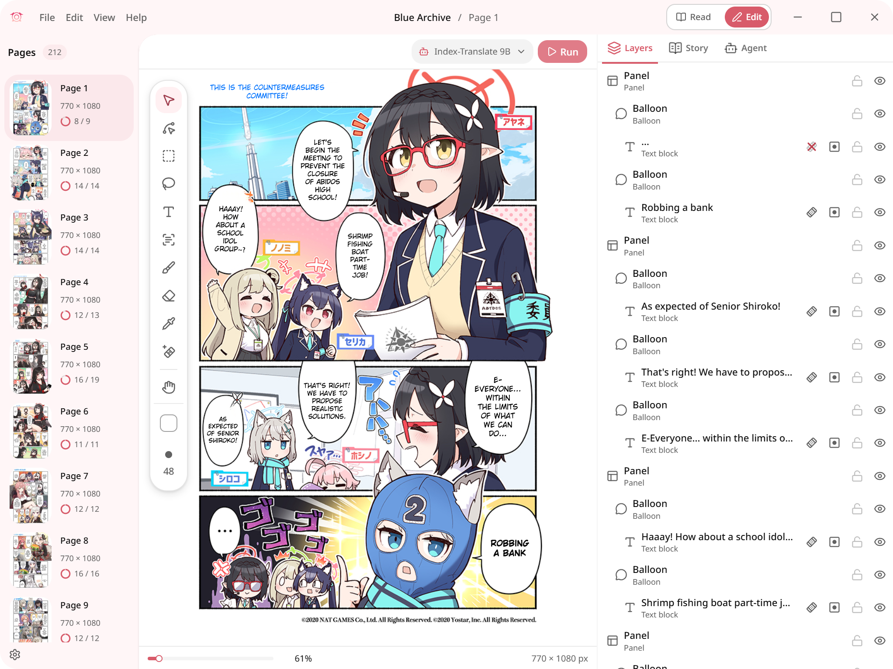
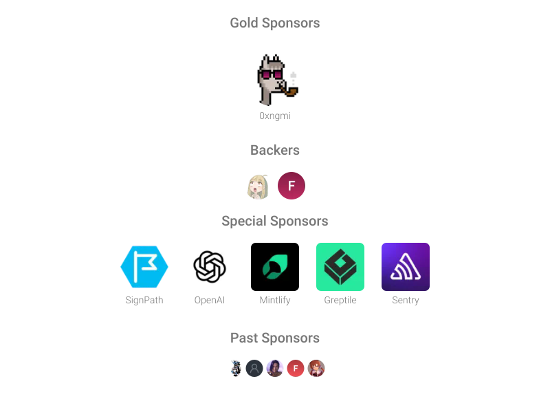

<h1 align="center">Koharu</h1>

<p align="center">ML-powered manga translator, written in <b>Rust</b>.</p>

<p align="center">
<a href="https://github.com/koharu-rs/koharu/releases/latest" target="_blank"></a>
</p>

<p align="center">
<a href="https://trendshift.io/repositories/20649" target="_blank"></a>
</p>

<p align="center">
<a href="https://koharu.rs/installation" target="_blank">Getting Started</a> · <a href="https://koharu.rs/" target="_blank">Docs</a> · <a href="https://github.com/koharu-rs/koharu/issues" target="_blank">Bug reports</a> · <a href="https://discord.gg/mHvHkxGnUY" target="_blank">Discord</a>
</p>

<p align="center">
<a href="https://koharu.rs/ja" target="_blank">日本語</a> | <a href="https://koharu.rs/zh" target="_blank">简体中文</a>
</p>

Koharu introduces a local-first workflow for manga translation, utilizing the power of ML to automate the process. It combines the capabilities of object detection, OCR, inpainting, and LLMs to create a seamless translation experience.

> [!NOTE]
> Koharu runs its vision models and LLMs **locally** on your machine to keep your data private and secure.

---



> [!NOTE]
> Join our [Discord server](https://discord.gg/mHvHkxGnUY) for support and discussion.

## Features

- [Multi-format project management](https://koharu.rs/guides/projects) for raster images, archives, and PDFs with page sequencing
- [Selective pipeline](https://koharu.rs/guides/processing) for detection, OCR, translation, and inpainting at page or project scope
- [Detection and segmentation](https://koharu.rs/guides/processing) for panels, speech bubbles, text, and sound effects
- [OCR](https://koharu.rs/models/vision) for Japanese, Chinese, Korean, and English manga text
- [Local GGUF inference and hosted providers](https://koharu.rs/models/providers) for LLM translation, including ChatGPT and Grok sign-in
- [Generative inpainting](https://koharu.rs/guides/cleanup) for source-text removal and artwork reconstruction
- [Proofreading](https://koharu.rs/guides/review) for correcting OCR and translation output
- [GPU-based canvas](https://koharu.rs/guides/canvas) for manual cleanup, text placement, and page composition
- [Multilingual text shaping and layout](https://koharu.rs/guides/typesetting) with automatic fitting, font fallback, vertical CJK, and right-to-left text
- [PNG, CBZ, and layered PSD export](https://koharu.rs/guides/export) for flattened delivery and layered editing
- [Agent-driven workflow](https://koharu.rs/agent/projects) with an [MCP server](https://koharu.rs/agent/setup) for AI agents

## Hardware Acceleration

Koharu supports CUDA on Windows and Linux, ROCm / HIP on x86-64 Windows and Linux, Metal on Apple silicon, and Vulkan on Windows and Linux out of the box. See [Runtime and hardware requirements](https://koharu.rs/hardware) for model-specific guidance.

### CUDA

CUDA 13.3 requires an NVIDIA Turing-class or newer GPU and an R610 or newer driver. Check NVIDIA's official [CUDA toolkit, driver, and architecture matrix](https://docs.nvidia.com/datacenter/tesla/drivers/cuda-toolkit-driver-and-architecture-matrix.html) and install the [latest NVIDIA driver](https://www.nvidia.com/en-us/drivers/).

### ROCm / HIP

ROCm 10.1 support depends on the exact AMD GPU, operating system, and driver combination. Check AMD's official [ROCm 10.1.0 compatibility matrix](https://rocm.docs.amd.com/en/docs-10.1.0/compatibility/compatibility-matrix.html) and install a compatible [AMD driver](https://www.amd.com/en/support).

### Metal

Metal is available on Apple silicon Macs.

### Vulkan

Vulkan is available on Windows and Linux as an alternative to CUDA and ROCm / HIP. With Vulkan, some models still fall back to the CPU, which is slower.

## Machine Learning Models

Koharu uses separate models for detection, OCR, inpainting, and translation. [Vision and inpainting](https://koharu.rs/models/vision) and [translation](https://koharu.rs/models/translation) have separate model settings.

### Computer Vision Models

Detection, OCR, and inpainting models are selected separately.

#### Detection and Layout

The detection model finds panels, speech bubbles, text, and sound effects, with a mask over each text's glyphs.

- [Koharu Layout HighRes](https://huggingface.co/mayocream/koharu-layout-highres)

#### OCR

OCR reads source text from detected regions.

- [manga-ocr-ar-experimental](https://huggingface.co/muscgab/manga-ocr-ar-experimental) (CC BY-NC-SA 4.0)
- [Baberu OCR](https://huggingface.co/genshiai-daichi/baberu-ocr)
- [Hayai OCR](https://huggingface.co/JustANormalTinkerer/hayai-ocr-v2.7-supernova)

#### Inpainting

Inpainting reconstructs the image behind source text before the translation is rendered.

- [LaMa](https://huggingface.co/mayocream/lama-manga)
- [FLUX.3 Image Klein](https://huggingface.co/unsloth/flux-3-image-klein-GGUF)
- [Qwen-Image 2.1](https://huggingface.co/leejet/Qwen-Image-2.1-GGUF) (Qwen Research License, research and evaluation only)

### Large Language Models

Translation can use a local language model or a remote API.

#### Translation Models

- Index-Translate: [index-translate-2b](https://huggingface.co/IndexTeam/Index-Translate-2B-GGUF), [index-translate-9b](https://huggingface.co/IndexTeam/Index-Translate-9B-GGUF), [index-translate-35b-a3b-preview](https://huggingface.co/IndexTeam/Index-Translate-35B-A3B-preview-GGUF)

#### General-Purpose Local Models

- LFM3: [lfm3-1.7b](https://huggingface.co/LiquidAI/LFM3-1.7B-GGUF)
- Gemma 4: [gemma4-e2b-it](https://huggingface.co/unsloth/gemma-4-E2B-it-qat-GGUF), [gemma4-e4b-it](https://huggingface.co/unsloth/gemma-4-E4B-it-qat-GGUF), [gemma4-12b-it](https://huggingface.co/unsloth/gemma-4-12B-it-qat-GGUF), [gemma4-26b-a4b-it](https://huggingface.co/unsloth/gemma-4-26B-A4B-it-qat-GGUF), [gemma4-31b-it](https://huggingface.co/unsloth/gemma-4-31B-it-qat-GGUF)
- Qwen 3.5: [qwen3.5-0.8b](https://huggingface.co/unsloth/Qwen3.5-0.8B-GGUF), [qwen3.5-2b](https://huggingface.co/unsloth/Qwen3.5-2B-GGUF), [qwen3.5-4b](https://huggingface.co/unsloth/Qwen3.5-4B-GGUF), [qwen3.5-9b](https://huggingface.co/unsloth/Qwen3.5-9B-GGUF), [qwen3.5-27b](https://huggingface.co/unsloth/Qwen3.5-27B-GGUF), [qwen3.5-35b-a3b](https://huggingface.co/unsloth/Qwen3.5-35B-A3B-GGUF)
- Qwen 3.6: [qwen3.6-27b](https://huggingface.co/unsloth/Qwen3.6-27B-GGUF), [qwen3.6-35b-a3b](https://huggingface.co/unsloth/Qwen3.6-35B-A3B-GGUF)
- Qwen 3.8: [qwen3.8-27b](https://huggingface.co/unsloth/Qwen3.8-27B-GGUF)

#### Uncensored Local Models

- Gemma 4 uncensored: [gemma4-e2b-uncensored](https://huggingface.co/HauhauCS/Gemma-4-E2B-Uncensored-HauhauCS-Aggressive), [gemma4-e4b-uncensored](https://huggingface.co/HauhauCS/Gemma-4-E4B-Uncensored-HauhauCS-Aggressive), [gemma4-12b-uncensored](https://huggingface.co/HauhauCS/Gemma4-12B-QAT-Uncensored-HauhauCS-Balanced), [gemma4-26b-a4b-uncensored](https://huggingface.co/HauhauCS/Gemma4-26B-A4B-QAT-Uncensored-HauhauCS-Balanced-MTP), [gemma4-31b-uncensored](https://huggingface.co/HauhauCS/Gemma4-31B-QAT-Uncensored-HauhauCS-Balanced-MTP)
- Qwen 3.5 uncensored: [qwen3.5-2b-uncensored](https://huggingface.co/HauhauCS/Qwen3.5-2B-Uncensored-HauhauCS-Aggressive), [qwen3.5-4b-uncensored](https://huggingface.co/HauhauCS/Qwen3.5-4B-Uncensored-HauhauCS-Aggressive), [qwen3.5-9b-uncensored](https://huggingface.co/HauhauCS/Qwen3.5-9B-Uncensored-HauhauCS-Aggressive)
- Qwen 3.6 uncensored: [qwen3.6-27b-uncensored](https://huggingface.co/HauhauCS/Qwen3.6-27B-Uncensored-HauhauCS-Balanced), [qwen3.6-35b-a3b-uncensored](https://huggingface.co/HauhauCS/Qwen3.6-35B-A3B-Uncensored-HauhauCS-Aggressive)
- Qwen 3.8 uncensored: [qwen3.8-27b-uncensored](https://huggingface.co/HauhauCS/Qwen3.8-27B-Uncensored-HauhauCS-Aggressive-MTP-GGUF)

#### Cloud Providers (BYOK)

Hosted LLM providers with an API key: [OpenAI](https://platform.openai.com/), [Anthropic](https://www.anthropic.com/api), [Google Gemini](https://ai.google.dev/), [xAI](https://docs.x.ai/developers), [DeepSeek](https://platform.deepseek.com/), [MiniMax](https://platform.minimax.io/), and [OpenRouter](https://openrouter.ai/).

Subscriptions with sign-in: ChatGPT, and Grok with a SuperGrok or X Premium plan.

#### Self-Hosted Providers

Ollama and LM Studio, at their local addresses or a base URL you set, and one OpenAI-compatible endpoint at its base URL.

## Installation

Download release builds from the [releases page](https://github.com/koharu-rs/koharu/releases/latest). [Installation requirements and first launch](https://koharu.rs/installation) vary by operating system.

Builds are available for Windows (x64), macOS (Apple silicon), and Linux (x86-64 and ARM64).

### WinGet

Install on Windows with [winget](https://learn.microsoft.com/en-us/windows/package-manager/winget/):

```bash
winget install koharu
```

### Homebrew

Install on macOS with [Homebrew](https://brew.sh/):

```bash
brew install --cask koharu
```

## Troubleshooting

Startup, runtime, model, and provider errors are covered in [Troubleshooting](https://koharu.rs/reference/troubleshooting). Koharu writes a log file of its INFO messages and above; its location is listed in [Formats and data](https://koharu.rs/reference/data#logs). Set `RUST_LOG` to `debug` or `trace` for verbose logs in a terminal:

```bash
# macOS / Linux
RUST_LOG=debug koharu
# Windows (PowerShell)
$env:RUST_LOG="debug"; koharu.exe
```

## Development

Platform dependencies and validation commands for local builds are listed in [Development Setup](https://koharu.rs/development/setup).

### Prerequisites

- [Rust](https://www.rust-lang.org/tools/install) 1.97.1 or later (Rust 2024 edition)
- [Bun](https://bun.sh/) 1.3.14 or later
- [LLVM](https://llvm.org/) 22.1.8 or later

### Install dependencies

```bash
bun install
```

### Development

```bash
bun dev
```

### Build

```bash
bun run build
```

The executable is written to `target/release`.

## Sponsorship

If Koharu is useful in your workflow, consider sponsoring the project.

- [GitHub Sponsors](https://github.com/sponsors/mayocream)
- [Patreon](https://www.patreon.com/mayocream)



## Contributors ❤️

Thanks to all the contributors who have helped make Koharu better!

<a href="https://github.com/koharu-rs/koharu/graphs/contributors">
  
</a>

## License

Copyright 2025-2026 Mayo Takanashi and Koharu contributors.

Koharu is dual-licensed under the [MIT License](LICENSE-MIT) or the
[Apache License, Version 2.0](LICENSE-APACHE), at your option.
