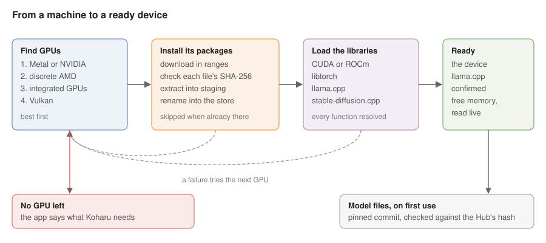

# koharu-runtime

`koharu-runtime` gets Koharu ready to run models on this machine. It finds the
GPU, installs the native libraries that run on it (libtorch, llama.cpp,
stable-diffusion.cpp, and the CUDA or ROCm libraries they need), downloads
pinned model files, and reports how much of the device's memory is free.
Everything it downloads is pinned and checked, and after the first install
nothing goes over the network.

```rust,ignore
let runtime = Runtime::start().await?;   // fails with Error::NoGpu on a machine without one
let device = runtime.device();
let Memory { free, total } = device.memory()?;
let weights = HuggingFaceFile::pinned(REPO, REVISION, "model.gguf").resolve().await?;
```



## Devices

- **Discovery.** CUDA (driver 13.3 or later, compute capability 7.5 or
  later), ROCm, Vulkan, and Metal on Apple silicon, ranked as now: Metal or a
  discrete NVIDIA GPU, a discrete AMD GPU, integrated GPUs, then Vulkan.
  Devices are named as llama.cpp names them (`CUDA0`, `ROCm0`, `Vulkan0`,
  `MTL0`).
- **A device is one llama.cpp found.** After its library loads, the runtime
  keeps only the devices llama.cpp lists, so a Vulkan loader on disk without a
  Vulkan device doesn't count.
- **Falling back.** Candidates are tried in rank order; one whose packages
  fail to install or load gives way to the next, until a library the runtime
  binds has loaded, as a loaded library can't be unloaded; a failure after
  that is final.
- **No GPU.** With no candidate left, `Runtime::start` fails with
  `Error::NoGpu`, naming what Koharu supports, and the app shows that message.
- **One device.** `Runtime::device()` is the device the runtime started on;
  nothing else hands out a device. It carries the names llama.cpp and the
  driver give it, its backend, its index as CUDA, HIP, and libtorch count
  devices, whether it's integrated, and the CUDA compute capability or AMD
  target models choose their precision from.
- **Memory.** `Device::memory()` reads free and total memory live from
  llama.cpp's backend device (`ggml_backend_dev_memory`) [ggml memory]. The
  pipeline's reserve and footprints are built on it; a `Device` no longer
  carries memory fields of its own.

## Packages

| Rule | Evidence |
|---|---|
| Every package is a pinned version with a SHA-256 for each file it downloads; each file is hashed once it's written, before it's moved into place, and a mismatch fails the install. | Cargo checks every crate against the SHA-256 its registry records [Cargo checksums]; pip's hash-checking mode refuses a file whose hash doesn't match [pip hashes] |
| A Hugging Face file is pinned to a commit and checked against the hash the Hub sends for it as `X-Linked-Etag`: an LFS file's SHA-256, or a file kept in git's blob SHA-1. | `huggingface_hub` reads the file's hash from `X-Linked-Etag` [HF etag] |
| Libraries load in dependency order (CUDA or ROCm, libtorch, llama.cpp, stable-diffusion.cpp), each resolving every function it binds before anything runs. | `koharu-bindgen`'s README |

An install downloads and extracts into a staging folder on the store's own
volume, off the async threads, and renames it into place under a lock that
holds across processes, as now. Once a new build of a package is running,
older builds of it are removed. The store's root is the app's install folder
in Windows release builds and the OS cache folder otherwise. llama.cpp and
stable-diffusion.cpp packages share one type, as they differ only in names.

## Downloads and HTTP

- **Large files** arrive in 64 MiB ranges over up to 32 connections, each range
  retried and checked, as now; Hugging Face files take the same path, so a
  7 GB model that fails near the end resumes instead of starting over.
- **One retry policy** (`backon`), with one meaning of "retries".
- **One HTTP client** for the app: its user agent, the proxies the OS and the
  environment set, a connect timeout, and a read timeout, so a stalled response
  fails instead of hanging [reqwest read timeout]. `koharu-llm` sends hosted
  requests through it. `[http]` holds the timeouts and retries; a zero timeout
  is invalid.

## Changes from today

- Downloads are checked against pinned hashes; today a package counts as
  installed if its files exist, and a file of unknown size can be cut short.
- Device memory is read live from llama.cpp; today `memory_free` is always 0
  and `memory_total` is set only for CUDA.
- A machine without a GPU gets a message instead of a panic, and a candidate
  that fails falls back to the next.
- Hugging Face files use the runtime's own downloader instead of `hf-hub`, a
  git dependency on a moving branch.
- The shared client gets a read timeout; the reqwest retry middleware, the
  hand-rolled per-read timeout, and `petgraph` go.
- Extraction and deletes move off the async threads, archives stage on the
  store's volume, and old runtime builds are removed.

## Sources

[ggml memory]: https://github.com/ggml-org/llama.cpp/blob/7aca0d2ea8d92b56911233b822db01f9fbb1ae50/ggml/include/ggml-backend.h#L185
[Cargo checksums]: https://doc.rust-lang.org/cargo/reference/registry-index.html#json-schema
[pip hashes]: https://pip.pypa.io/en/stable/topics/secure-installs/
[HF etag]: https://github.com/huggingface/huggingface_hub/blob/feea5a63f9c725e98f98a0bb899875ec5efa673b/src/huggingface_hub/constants.py#L95
[reqwest read timeout]: https://docs.rs/reqwest/0.13.5/reqwest/struct.ClientBuilder.html#method.read_timeout
