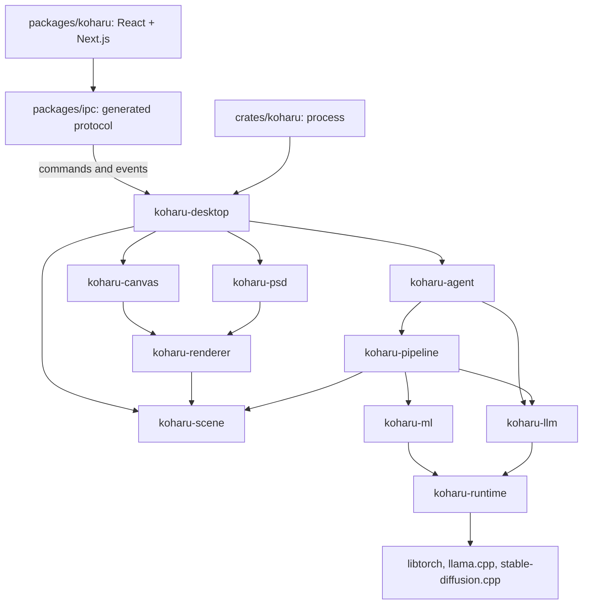

Koharu runs as a desktop application. React invokes typed Tauri commands; native components own durable project state, processing, and drawing.

## Interface and application

| Component         | Responsibility                                                                                                               |
| ----------------- | ---------------------------------------------------------------------------------------------------------------------------- |
| `packages/koharu` | Start view, page list, processing selector, layers, story, type bar, history, Agent panel, settings, and the activity center |
| `packages/ui`     | Shared React primitives and styling                                                                                          |
| `packages/ipc`    | The TypeScript protocol generated from the desktop's commands and events                                                     |
| `crates/koharu`   | The process: crash reporting, logs, panics, and the order the app starts in                                                  |
| `koharu-desktop`  | The window, the commands, the projects folder, import and export, preferences, and the MCP server                            |
| `koharu-sentry`   | Sentry for the interface and the native side as one app                                                                      |

The interface renders off-screen in CEF, and the window composites it over the native canvas, which draws the page. The interface reads and edits the open project through the scene's queries and edits, the same protocol the agent and MCP clients use. Every change is broadcast to the window, whichever writer made it, so the canvas and the panels redraw without polling. Preferences are `config.toml` sections, each handed to the component that owns it when saved.

<Note>
  Rust signatures generate `packages/ipc/src/protocol.ts`. Change the Rust source and [regenerate
  bindings](/development/setup#regenerate-ipc-bindings).
</Note>

## Scene and processing

`koharu-scene` owns the project file, its pages and layers, edits, and undo history.

`koharu-pipeline` runs detection, OCR, inpainting, and translation over pages, text blocks, or a painted area, and owns scheduling, model residency, and stopping. `koharu-ml` owns the vision models; `koharu-llm` owns the local and hosted language models and provider sign-in. `koharu-agent` owns the agent and the tools it and MCP clients share.

## Rendering

`koharu-renderer` draws a page with vello on the GPU: it lays out text, composites layers, and produces pixels. The canvas, PNG and PSD export, and thumbnails all draw through it, so every output matches what the editor shows. `koharu-canvas` owns the camera, hit-testing, selection, and tool gestures, and answers edits that the desktop applies. `koharu-psd` writes a page as a layered Photoshop document.

## Native runtime boundary

Safe wrappers `koharu-torch`, `koharu-llama`, and `koharu-diffusion` are separate from the `-sys` crates that declare libtorch's, llama.cpp's, and stable-diffusion.cpp's C APIs. `koharu-bindgen` generates those declarations so they resolve when the libraries are opened at runtime. `koharu-runtime` picks the GPU, downloads and opens the libraries, and fetches model files.

Two crates are shared across the diagram and omitted from it: `koharu-config` owns the typed sections of `config.toml` and the encrypted secrets, whose key is kept in the operating system credential store, and `koharu-leptonica` ports the Leptonica algorithms `koharu-ml` uses to measure lettering.

<CardGroup cols={2}>
  <Card title="Scene and storage" icon="database" href="/development/scene">
    Trace layers, edits, history, and the project file.
  </Card>

  <Card title="Processing and rendering" icon="layer-group" href="/development/rendering">
    Follow runs through the renderer and the window.
  </Card>
</CardGroup>
