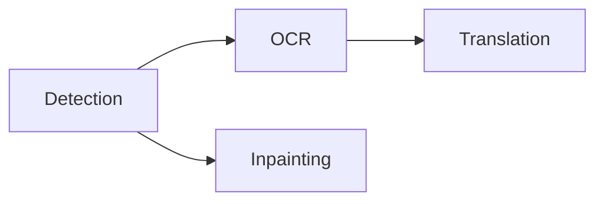

## Schedule runs

`koharu-pipeline` takes a request: a target, a set of stages, and optionally settings for that run only.

| Target                     | Stages                                             |
| -------------------------- | -------------------------------------------------- |
| The project, or some pages | Any of detection, OCR, inpainting, and translation |
| Some text blocks           | OCR, inpainting, and translation                   |
| A painted area             | Inpainting                                         |

A run is a graph of its pages' stages: detection before a page's other stages, OCR before its translation, and each page's translation before the next page's, since translation is one conversation in page order. A stage never runs another, and a stage with nothing to do succeeds without work. Runs on blocks or an area go first, then runs on pages in the order they came. Up to three pages are in flight: one reading its input, one on the model, and one writing its result.

Each stage writes its result for a page as one undo step labelled with the stage's name. The first failure ends its run, naming the page, the stage, and the reason; what the run finished stays.

## Manage residency and stopping

Models load the first time a stage needs one, on the one thread that owns them, and run one call at a time there, so peak memory is every loaded model plus the largest working set. A local language model decodes on its own thread beside it. Nothing is unloaded to make room: a model that does not fit fails, naming the free memory. A model leaves when the settings switch away from it or the pipeline ends.

Stopping stops every run, running and queued. A stopped run writes nothing more.

## Prepare a frame

`koharu-renderer` turns a page of the open session into an immutable frame and draws it with vello on the GPU. A layer's content is cached by what it depends on, such as its text and fonts, so a render after an edit reuses every layer the edit did not touch. A view draws only the rectangle and level of detail it needs.

Text size, line breaks, and placement are worked out at every render and nowhere else, so nothing stores a result that can go stale. A page may be up to 32,768 pixels on a side and 268,435,456 pixels in all.

<Note>
  The canvas, PNG and PSD export, and thumbnails draw through the same painter on the same GPU, so
  every output matches what the editor shows.
</Note>

## Present in the window

The window draws three layers on its own surface: the native canvas, then the React interface, then any popup the interface opens, such as an open `<select>`. CEF renders the interface off-screen and hands over each paint as a GPU texture where the GPU can take it, or copied through memory otherwise. The page shows wherever the interface is transparent.

The pointer goes to the canvas where the interface painted nothing over it and to the interface everywhere else; keys, including input-method composition, go to the interface. `koharu-canvas` turns the pointer into gestures, previews them in an overlay, and answers edits that the desktop applies like any other writer's.

## Inspect the desktop result

Debug builds expose CEF's DevTools protocol at `http://127.0.0.1:4000`, in a browser profile of their own. Use it to inspect and drive the interface. A CDP screenshot shows only the interface, so capture the composited window, canvas included, with the debug build's `capture` command.
