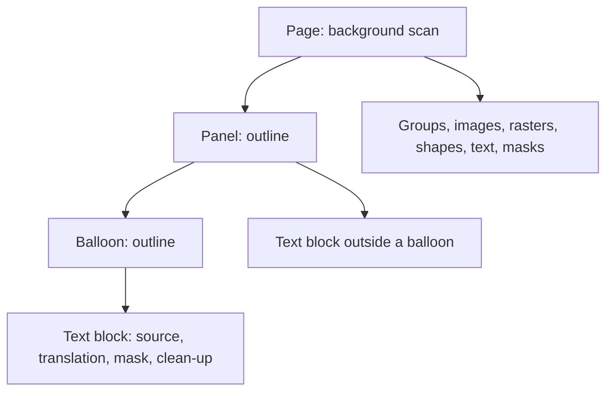

`koharu-scene` owns what a project means and how it is stored.

## Layers and manga kinds

A project holds ordered pages. Each page has a background, the imported scan, and a tree of layers. Ordinary layers follow Photoshop: groups, images, rasters, shapes, text, and masks. Three kinds follow Clip Studio Paint's frames and balloons and hold a manga page's parts:

A text block is one text of the page. Its source is never drawn; its translation is. Its mask covers the source glyphs, and its clean-up is a raster shown only inside that mask, under the translation. Each pipeline stage writes its own fields of a block, so a new model for a stage writes the same fields. Namespaced attributes carry data for tools, such as a C2PA record of what a model did; the renderer never reads them.

## Apply an edit

Every writer edits a project the same way: the editor, a pipeline run, and the agent. An edit carries an undo label and its changes and applies whole or not at all. A layer patch is a JSON Merge Patch read back into the layer's types, so a misspelled property or a value of the wrong shape fails and leaves the layer as it was.

<Note>
  The last writer of any value wins, model or user. A rerun replaces your changes, and undo is the
  way back. The workflow decides which fields a run writes; the scene enforces none of it.
</Note>

## Store a project

A project is one SQLite file with the `.khr` extension, page images included. Every edit is kept as it applies, so there is no save and no unsaved state. Raster pixels are stored in 64×64 tiles, each compressed on its own, and only tiles that hold pixels are stored. An open project is locked exclusively, so a second writer finds it locked at once.

## History

History lists each step's label, oldest first, and moves back or forward to any of them. It keeps the 20 most recent steps and lasts as long as the project is open, as closing a Photoshop document clears its states.

## Open and version

Opening fails closed: a value of the wrong shape, an unknown kind, missing pixels, or a file that is not a project fails to open and is left as it was. The project's `version` is a SemVer version that changes only with the core schema. A reader opens any version up to its own within the same major version; a newer version fails to open.

## Keep application ownership separate

The desktop owns the projects folder and project names. The renderer, pipeline, and agent read the open session and submit edits; they do not write the file directly.
