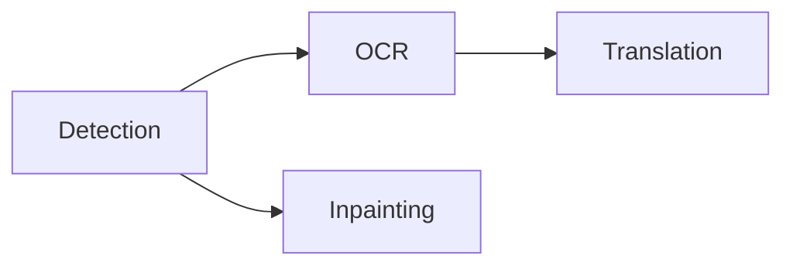

The processing selector above the canvas sets the model, page scope, stages, and target language. Start with the smallest scope that covers the work.

## Choose a scope

<Tabs>
  <Tab title='Current page'>Process the page currently shown on the canvas.</Tab>
  <Tab title='Selected pages'>Process the pages selected in the page list.</Tab>
  <Tab title='Entire project'>Process every page in project order.</Tab>
  <Tab title='Selected layers'>
    Choose **Process → Process Selected Layers** after correcting or adding a few text blocks. It
    runs OCR and translation on the selected text blocks only.
  </Tab>
</Tabs>

## Choose stages

Select one or more stages, then choose **Run**. Selected stages always run in this order:

Detection finds panels, speech bubbles, and text blocks, with a mask over each block's source glyphs. OCR reads each block's source text. Inpainting rebuilds the artwork under each mask. Translation writes each block's translation and places it in its room in the balloon, or in its source's frame when it has no balloon.

<Note>
  Omitted stages are not added. Include detection or OCR when a later stage needs fresh input.
</Note>

The **Process** menu also offers **Process Project** and **Process Selected Pages**, which run all four stages, and **Run Detection**, **Run OCR**, **Run Inpainting**, and **Run Translation**. A **Run** item runs the named stage and every stage before it in the order Detection, OCR, Inpainting, Translation, and always covers the entire project, regardless of the scope selector.

## Follow progress and stop work

The activity center shows each run's stage, page, progress, and failures. Runs started while another is going wait their turn; runs on text blocks or a painted area go first. **Stop** stops every run, running and queued.

Each stage writes its result for a page as one undo step as soon as it finishes. Completed work stays when a later stage fails or the run stops. The first failure ends its run and names the page, stage, and reason.

A stage with nothing to do, such as OCR on a page without text, does nothing and does not fail.

<Warning>
  A rerun replaces what is there, your own edits included, and undo is the way back. Detection
  replaces a page's panels, balloons, and text blocks, but leaves locked ones as they are. OCR
  rewrites source text, and translation rewrites each translation's wording and placement.
</Warning>

Continue with [text review](/guides/review) or [cleanup](/guides/cleanup).
