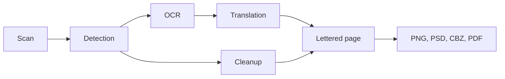

Koharu turns a scan into a lettered page in four stages. Each stage writes ordinary project data: layers you can select, edit, hide, and undo. A result is a starting point you keep working on, not a finished image.

## What each stage writes

<Steps>
  <Step title='Detection'>
    **Koharu Layout HighRes** reads the scan and writes the page's panels, balloons, and text blocks
    in reading order, with each block's frame, tilt, direction, and mask. See [detection and
    OCR](/how-it-works/detection).
  </Step>
  <Step title='OCR'>
    **Hayai OCR** reads the scan inside each block's frame and writes the block's source text. See
    [OCR](/how-it-works/detection#ocr).
  </Step>
  <Step title='Cleanup'>
    The **Inpainting** stage, **LaMa** by default, reads the scan with each block's mask, balloon,
    and panel, and writes each block's clean-up, shown through its mask. See
    [cleanup](/how-it-works/cleanup).
  </Step>
  <Step title='Translation'>
    **Index-Translate 9B** reads the page's source texts in reading order, and with **Vision** the
    scan, and writes each block's translation and where it goes. See
    [translation](/how-it-works/translation).
  </Step>
</Steps>

There is no typesetting stage. Translation places each text as it writes it, and the renderer fits it to its frame every time it draws the page. See [fitting translations](/how-it-works/lettering).

## Rules every run follows

- **A run does what it was asked.** It runs the stages you chose on the pages or texts you gave it. It never decides that a page needs no work, and nothing reruns because something it read changed: fix a source text, and its translation stays as it was until you translate that text again.
- **A stage never runs another.** OCR without detection reads the blocks already there. A stage with nothing to do, such as OCR on a page without text, does nothing and doesn't fail.
- **A rerun replaces.** A model's result overwrites what is there, your own edits included, and undo is the way back. A lock is the exception: no stage writes a locked text block or one inside a locked layer.
- **Each page's stage is one undo step,** written as soon as it finishes, so a run that stops or fails keeps what it finished.
- **A failure belongs to a page or to the run.** A page the translation model blocks or can't answer is left untranslated, and the run goes on. Any other failure would happen again on the next page, so it ends the run and names the page, the stage, and the reason.
- **Nothing runs by itself.** A model runs when you choose **Run**, run a stage from a page's or a text's menu, release a **Remove** stroke, choose **Generate**, or ask the Agent.

## Where it runs

Detection, OCR, cleanup, and Koharu's own translation models run on your GPU, which also draws the page. A hosted provider you connect receives what translation or the Agent sends it: each page's text, and the page image when **Vision** is on. See [models on your GPU](/how-it-works/runtime).

## In this section

<Columns cols={2}>
  <Card title='Pages, layers, and history' icon='layers' href='/how-it-works/projects'>
    What a project holds, how a text block keeps its four parts, and how edits and undo work.
  </Card>
  <Card title='Detection and OCR' icon='search' href='/how-it-works/detection'>
    How Koharu finds lettering, orders it, measures it, and reads it.
  </Card>
  <Card title='Cleanup' icon='eraser' href='/how-it-works/cleanup'>
    Why most lettering is filled without a model, and how the model redraws the rest.
  </Card>
  <Card title='Translation' icon='languages' href='/how-it-works/translation'>
    One conversation per project, what the model receives, and when a page is asked again.
  </Card>
  <Card title='Fitting translations' icon='a-large-small' href='/how-it-works/lettering'>
    Where a translation goes, how large it's lettered, and how it gets its colours.
  </Card>
  <Card title='Drawing the page' icon='pen-tool' href='/how-it-works/rendering'>
    One renderer for the canvas and every export, vertical text, ruby, and fonts.
  </Card>
  <Card title='Models on your GPU' icon='cpu' href='/how-it-works/runtime'>
    Which GPU runs the models, what downloads, and how memory and runs are shared.
  </Card>
</Columns>

<Note>
  These pages explain behaviour you can see in the app. The design behind each part, with its
  measurements and sources, is in the README of the crate that owns it, linked at the end of each
  page.
</Note>

Design and sources: the [`koharu-pipeline` README](https://github.com/koharu-rs/koharu/blob/main/crates/koharu-pipeline/README.md).
