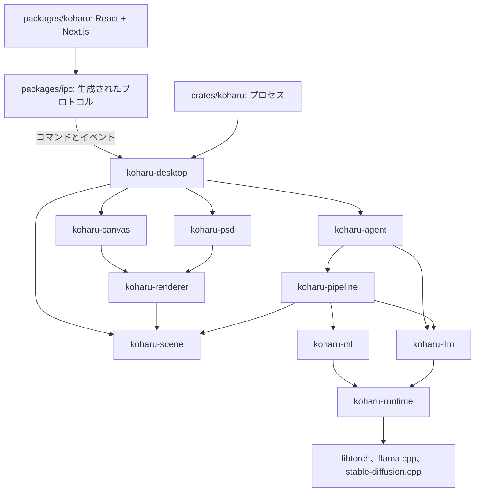

Koharu はデスクトップアプリとして動作します。React は型付きの Tauri コマンドを呼び出し、永続的なプロジェクト状態、処理、描画はネイティブ側のコンポーネントが担います。

## インターフェースとアプリケーション

| コンポーネント      | 責務                                                                                                                                   |
| ------------------- | -------------------------------------------------------------------------------------------------------------------------------------- |
| `packages/koharu`   | スタート画面、ページ一覧、処理セレクター、レイヤー、ストーリー、書式バー、ヒストリー、エージェントパネル、設定、アクティビティセンター |
| `packages/ui`       | 共通の React プリミティブとスタイル                                                                                                    |
| `packages/ipc`      | デスクトップのコマンドとイベントから生成された TypeScript プロトコル                                                                   |
| `crates/koharu`     | プロセス: クラッシュレポート、ログ、パニック、アプリの起動順序                                                                         |
| `koharu-desktop`    | ウィンドウ、コマンド、プロジェクトフォルダー、読み込みと書き出し、設定、MCP サーバー                                                   |
| `koharu-sentry`     | インターフェースとネイティブ側を 1 つのアプリとして扱う Sentry                                                                         |
| `koharu-extensions` | ギャラリーが読むサイト。コミットに固定した [koharu-rs/extensions](https://github.com/koharu-rs/extensions) から取得します              |

インターフェースは CEF でオフスクリーン描画され、ウィンドウはページを描くネイティブキャンバスの上にそれを合成します。インターフェースは、エージェントや MCP クライアントと同じシーンのクエリと編集を通じて、開いているプロジェクトを読み書きします。変更は書き手を問わずすべてウィンドウに通知されるため、キャンバスとパネルはポーリングせずに再描画されます。設定は `config.toml` のセクションで、保存時にそれぞれの担当コンポーネントへ渡されます。

<Note>
  `packages/ipc/src/protocol.ts` は Rust のシグネチャから生成されます。Rust
  のソースを変更し、[バインディングを再生成](/ja/development/setup)してください。
</Note>

## シーンと処理

`koharu-scene` はプロジェクトファイル、ページとレイヤー、編集、取り消し履歴を担います。

`koharu-pipeline` はページ、テキストブロック、塗った範囲に対して検出、OCR、インペイント、翻訳を実行し、スケジューリング、モデルの常駐、停止を担います。`koharu-ml` は画像系モデル、`koharu-llm` はローカルとホスト型の言語モデルとプロバイダーのサインインを担います。`koharu-agent` はエージェントと、エージェントと MCP クライアントが共有するツールを担います。

## 描画

`koharu-renderer` は vello で GPU 上にページを描画します。テキストのレイアウト、レイヤーの合成、ピクセルの生成を行います。キャンバス、PNG と PSD の書き出し、サムネイルはすべてこれを通して描かれるため、どの出力もエディターの表示と一致します。`koharu-canvas` はカメラ、ヒットテスト、選択、ツールのジェスチャーを担い、デスクトップが適用する編集を返します。`koharu-psd` はページをレイヤー付きの Photoshop ドキュメントとして書き出します。

## ネイティブランタイムの境界

安全なラッパーである `koharu-torch`、`koharu-llama`、`koharu-diffusion` は、libtorch、llama.cpp、stable-diffusion.cpp の C API を宣言する `-sys` クレートから分離されています。`koharu-bindgen` はそれらの宣言を、実行時にライブラリを開いたときに解決されるよう生成します。`koharu-runtime` は GPU を選び、ライブラリをダウンロードして開き、モデルファイルを取得します。

図に共通して使われるため省略したクレートが 2 つあります。`koharu-config` は `config.toml` の型付きセクションと暗号化されたシークレットを担い、その鍵は OS の資格情報ストアに保管されます。`koharu-leptonica` は `koharu-ml` が文字の計測に使う Leptonica のアルゴリズムを移植したものです。

## 設計を読む

各クレートの README がその設計です。目的、各部分のモデルと倣った既存製品、出典が書かれています。変更する前に、担当クレートの README を読んでください。

| 領域                 | README                                                                                                                                                                                                                                                                                                                                                                                                                                                                                                    |
| -------------------- | --------------------------------------------------------------------------------------------------------------------------------------------------------------------------------------------------------------------------------------------------------------------------------------------------------------------------------------------------------------------------------------------------------------------------------------------------------------------------------------------------------- |
| アプリケーション     | [`koharu`](https://github.com/koharu-rs/koharu/blob/main/crates/koharu/README.md)、[`koharu-desktop`](https://github.com/koharu-rs/koharu/blob/main/crates/koharu-desktop/README.md)、[`koharu-canvas`](https://github.com/koharu-rs/koharu/blob/main/crates/koharu-canvas/README.md)、[`koharu-config`](https://github.com/koharu-rs/koharu/blob/main/crates/koharu-config/README.md)、[`koharu-sentry`](https://github.com/koharu-rs/koharu/blob/main/crates/koharu-sentry/README.md)                   |
| プロジェクトと描画   | [`koharu-scene`](https://github.com/koharu-rs/koharu/blob/main/crates/koharu-scene/README.md)、[`koharu-renderer`](https://github.com/koharu-rs/koharu/blob/main/crates/koharu-renderer/README.md)、[`koharu-psd`](https://github.com/koharu-rs/koharu/blob/main/crates/koharu-psd/README.md)                                                                                                                                                                                                             |
| モデルと実行         | [`koharu-pipeline`](https://github.com/koharu-rs/koharu/blob/main/crates/koharu-pipeline/README.md)、[`koharu-ml`](https://github.com/koharu-rs/koharu/blob/main/crates/koharu-ml/README.md)、[`koharu-llm`](https://github.com/koharu-rs/koharu/blob/main/crates/koharu-llm/README.md)、[`koharu-agent`](https://github.com/koharu-rs/koharu/blob/main/crates/koharu-agent/README.md)、[`koharu-leptonica`](https://github.com/koharu-rs/koharu/blob/main/crates/koharu-leptonica/README.md)             |
| ネイティブランタイム | [`koharu-runtime`](https://github.com/koharu-rs/koharu/blob/main/crates/koharu-runtime/README.md)、[`koharu-torch`](https://github.com/koharu-rs/koharu/blob/main/crates/koharu-torch/README.md)、[`koharu-llama`](https://github.com/koharu-rs/koharu/blob/main/crates/koharu-llama/README.md)、[`koharu-diffusion`](https://github.com/koharu-rs/koharu/blob/main/crates/koharu-diffusion/README.md)、[`koharu-bindgen`](https://github.com/koharu-rs/koharu/blob/main/crates/koharu-bindgen/README.md) |

<Columns cols={2}>
  <Card title="シーンとストレージ" icon="database" href="/ja/development/scene">
    編集、属性、バージョン管理、プロジェクトファイルの担当範囲。
  </Card>

  <Card title="処理と描画" icon="layers" href="/ja/development/rendering">
    パイプラインへのリクエスト、レンダラーのフレーム、ウィンドウ。
  </Card>
</Columns>

翻訳する人から見た各部分の動作は[Koharu のしくみ](/ja/how-it-works)を参照してください。
