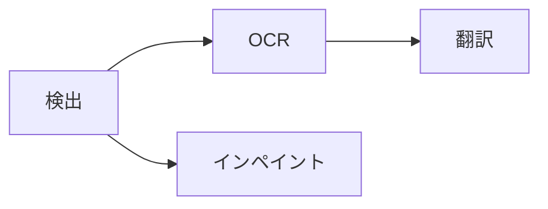

## 実行をスケジュールする

`koharu-pipeline` はリクエストを受け取ります。リクエストは対象、工程の集合、必要ならその実行だけの設定からなります。

| 対象                             | 工程                                    |
| -------------------------------- | --------------------------------------- |
| プロジェクト、または一部のページ | 検出、OCR、インペイント、翻訳のいずれか |
| 一部のテキストブロック           | OCR、インペイント、翻訳                 |
| 塗った範囲                       | インペイント                            |

実行はページごとの工程からなるグラフです。ページの検出はそのページの他の工程より先、OCR は翻訳より先に行われます。翻訳はページ順の 1 つの会話なので、各ページの翻訳は次のページの翻訳より先です。工程が別の工程を起動することはなく、やることがない工程は何もせずに成功します。テキストブロックや範囲への実行が先に進み、続いてページへの実行が届いた順に進みます。同時に扱うページは最大 3 つで、入力を読むもの、モデルにかかっているもの、結果を書くものです。

各工程はページごとの結果を、工程名のラベルが付いた 1 つの取り消しステップとして書き込みます。最初の失敗でその実行は終わり、ページ、工程、理由が示されます。完了した分は残ります。

## 常駐と停止を管理する

モデルは工程で初めて必要になったときに、モデルを所有する 1 つのスレッドで読み込まれ、そこで 1 回に 1 つずつ実行されます。そのためピークメモリは、読み込まれたすべてのモデルに最大の作業領域を足した量になります。ローカル言語モデルはその横の専用スレッドでデコードします。空きを作るためにモデルを解放することはなく、収まらないモデルは空きメモリを示して失敗します。モデルは設定で別のモデルに切り替えたとき、またはパイプラインの終了時に解放されます。

停止すると、実行中と待機中のすべての実行が止まります。停止した実行はそれ以上何も書き込みません。

## フレームを準備する

`koharu-renderer` は開いているセッションのページを不変のフレームにし、vello で GPU 上に描画します。レイヤーの内容はテキストやフォントなど依存するものごとにキャッシュされるため、編集後の描画では編集に関係しないレイヤーがすべて再利用されます。ビューは必要な範囲と詳細度だけを描画します。

テキストのサイズ、改行、配置は描画のたびにここでだけ計算されるため、古くなる結果を保存することはありません。ページは 1 辺 32,768 ピクセル、合計 268,435,456 ピクセルまで扱えます。

<Note>
  キャンバス、PNG と PSD の書き出し、サムネイルは、同じ GPU
  上の同じ描画処理を通るため、どの出力もエディターの表示と一致します。
</Note>

## ウィンドウに表示する

ウィンドウは自身のサーフェスに 3 層を描きます。ネイティブキャンバス、その上に React のインターフェース、さらに開いた `<select>` などのポップアップです。CEF はインターフェースをオフスクリーンで描画し、GPU が受け取れる場合は GPU テクスチャとして、そうでない場合はメモリ経由のコピーとして各描画を渡します。インターフェースが透明な部分からページが見えます。

ポインターは、インターフェースが何も描いていない場所ではキャンバスへ、それ以外ではインターフェースへ届きます。キー入力は IME の変換も含めてインターフェースへ届きます。`koharu-canvas` はポインターをジェスチャーに変え、オーバーレイでプレビューし、デスクトップが他の書き手と同じように適用する編集を返します。

## デスクトップでの結果を確認する

デバッグビルドは専用のブラウザープロファイルで、CEF の DevTools プロトコルを `http://127.0.0.1:4000` に公開します。インターフェースの検査や操作に使います。CDP のスクリーンショットにはインターフェースしか写らないため、キャンバスを含む合成済みのウィンドウは、デバッグビルドの `capture` コマンドで取得します。
