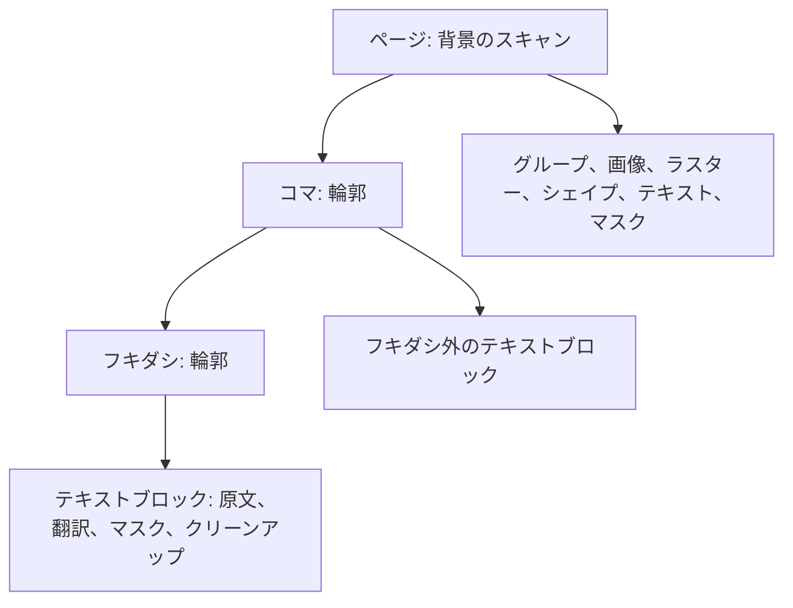

`koharu-scene` は、プロジェクトが何を意味し、どのように保存されるかを担います。

## レイヤーとマンガ用の種類

プロジェクトは順序付きのページを持ちます。各ページには背景（読み込んだスキャン）とレイヤーのツリーがあります。通常のレイヤーは Photoshop に倣い、グループ、画像、ラスター、シェイプ、テキスト、マスクがあります。CLIP STUDIO PAINT のコマと吹き出しに倣った 3 つの種類が、マンガのページの部品を保持します。

テキストブロックはページ上の 1 つのテキストです。原文は描画されず、翻訳が描画されます。マスクは原文の字形を覆い、クリーンアップはそのマスクの内側だけ、翻訳の下に表示されるラスターです。パイプラインの各工程はブロックの自分のフィールドだけを書き込むため、工程のモデルを替えても同じフィールドに書き込みます。名前空間付きの属性は、モデルが行った処理の C2PA 記録など、ツール向けのデータを持ちます。レンダラーは属性を読みません。

## 編集を適用する

エディター、パイプラインの実行、エージェントのどれもが、同じ方法でプロジェクトを編集します。編集は取り消し用のラベルと変更内容を持ち、全体が適用されるか、まったく適用されないかのどちらかです。レイヤーへのパッチは JSON Merge Patch で、レイヤーの型として読み直されるため、プロパティ名の誤りや形の違う値は失敗し、レイヤーは元のままです。

<Note>
  値はモデルかユーザーかを問わず、最後に書いたものが優先されます。再実行は手動の変更も置き換え、戻すには取り消しを使います。どの工程がどのフィールドを書くかはワークフローが決め、シーンは強制しません。
</Note>

## プロジェクトを保存する

プロジェクトは拡張子 `.khr` の SQLite ファイル 1 つで、ページの画像も含みます。編集は適用されるたびに保存されるため、保存操作も未保存の状態もありません。ラスターのピクセルは 64×64 のタイルごとに個別に圧縮して保存され、ピクセルを含むタイルだけが保存されます。開いているプロジェクトは排他ロックされるため、2 つ目の書き手はすぐにロックに気づきます。

## 履歴

履歴は各ステップのラベルを古い順に並べ、任意のステップへ戻ったり進んだりできます。直近 20 ステップを保持し、Photoshop でドキュメントを閉じると状態が消えるのと同じく、プロジェクトを開いている間だけ残ります。

## 開くこととバージョン

開くときは安全側に失敗します。形の違う値、未知の種類、欠けたピクセル、プロジェクトではないファイルは開けず、ファイルはそのまま残ります。プロジェクトの `version` は SemVer で、コアのスキーマが変わったときだけ変わります。同じメジャーバージョン内なら、自分以下のバージョンを開けます。新しいバージョンは開けません。

## アプリケーションの責務を分ける

デスクトップはプロジェクトフォルダーとプロジェクト名を担います。レンダラー、パイプライン、エージェントは開いているセッションを読み、編集を送ります。ファイルに直接書き込むことはありません。
