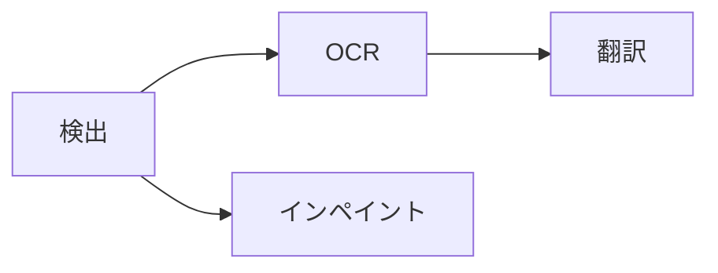

キャンバス上部の処理セレクターでモデル、ページの範囲、工程、対象言語を選びます。作業に必要な最小範囲から始めてください。

## 範囲を選ぶ

<Tabs>
  <Tab title='選択したページ'>ページ一覧で選択したページを処理します。</Tab>
  <Tab title='プロジェクト全体'>プロジェクト順にすべてのページを処理します。</Tab>
  <Tab title='1 つのテキスト'>
    **ストーリー**でテキストブロックにポインターを合わせるか選択し、番号の下の翻訳ボタンを選びます。そのテキストブロックだけを翻訳します。
  </Tab>
</Tabs>

## 工程を選ぶ

1 つ以上の工程を選び、**実行**します。選択した工程は常に次の順に進みます。

検出はコマ、吹き出し、テキストブロックを見つけ、各ブロックの原文の字形を覆うマスクを作ります。OCR は各ブロックの原文を読み取ります。インペイントは各マスクの下の画像を再構成します。翻訳は各ブロックの翻訳を書き込み、吹き出し内のそのブロックの領域、吹き出しがない場合は原文の枠に配置します。

<Note>
  省略した工程は自動追加されません。後の工程に新しい入力が必要なら、検出や OCR も選びます。
</Note>

## 進捗と停止

アクティビティセンターには、各実行の工程、ページ、進捗、失敗が表示されます。別の実行中に始めた実行は順番を待ちます。テキストブロックや塗った範囲への実行が先に進みます。**停止**は実行中と待機中のすべての実行を止めます。

各工程は終わり次第、ページごとの結果を 1 つの取り消しステップとして書き込みます。後の工程が失敗したり実行を停止したりしても、完了した結果は残ります。最初の失敗でその実行は終わり、ページ、工程、理由が示されます。

テキストのないページでの OCR のように、やることがない工程は何もせず、失敗にもなりません。

<Warning>
  再実行は手動の編集も含めて既存の内容を置き換えます。戻すには取り消しを使います。検出はページのコマ、吹き出し、テキストブロックを置き換えますが、ロックしたものはそのまま残します。OCR
  は原文を、翻訳は各翻訳の文面と配置を書き換えます。
</Warning>

続いて[テキストの確認](/ja/guides/review)や[画像修復](/ja/guides/cleanup)を行います。
