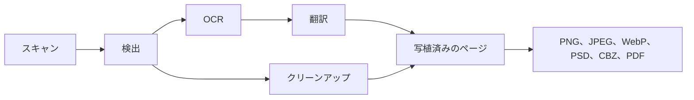

Koharu は 4 つの工程でスキャンを写植済みのページにします。各工程は通常のプロジェクトデータ、つまり選択、編集、非表示、取り消しができるレイヤーを書き込みます。結果は完成した画像ではなく、そこから作業を続けるための出発点です。

## 各工程が書き込むもの

<Steps>
  <Step title='検出'>
    **Koharu Layout HighRes**
    がスキャンを読み、ページのコマ、吹き出し、テキストブロックを読み順に書き込みます。各ブロックには枠、傾き、方向、マスクが付きます。[検出と
    OCR](/ja/how-it-works/detection)を参照してください。
  </Step>
  <Step title='OCR'>
    **Hayai OCR**
    が各ブロックの枠内のスキャンを読み、ブロックの原文を書き込みます。[OCR](/ja/how-it-works/detection#ocr)を参照してください。
  </Step>
  <Step title='クリーンアップ'>
    **インペイント**工程（既定は
    **LaMa**）が、スキャンと各ブロックのマスク、吹き出し、コマを読み、マスク越しに表示される各ブロックのクリーンアップを書き込みます。[クリーンアップ](/ja/how-it-works/cleanup)を参照してください。
  </Step>
  <Step title='翻訳'>
    **Index-Translate 9B**
    がページの原文を読み順に、**ビジョン**がオンならスキャンも読み、各ブロックの翻訳とその配置を書き込みます。[翻訳](/ja/how-it-works/translation)を参照してください。
  </Step>
</Steps>

写植の工程はありません。翻訳は訳文を書くと同時に配置し、レンダラーはページを描くたびに訳文を枠に収めます。[訳文の収め方](/ja/how-it-works/lettering)を参照してください。

## どの実行も従うルール

- **実行は指示されたことだけを行います。** 選んだ工程を、指定したページやテキストに実行します。ページに作業が要らないと判断することはなく、読んだものが変わっても再実行はされません。原文を直しても、そのテキストを翻訳し直すまで翻訳は元のままです。
- **工程がほかの工程を呼ぶことはありません。** 検出なしの OCR は、すでにあるブロックを読みます。テキストのないページへの OCR のように、することのない工程は何もせず、失敗にもなりません。
- **再実行は置き換えます。** モデルの結果は、手動の編集も含めてそこにあるものを上書きし、戻すには取り消しを使います。例外はロックです。ロックしたテキストブロックや、ロックしたレイヤー内のブロックには、どの工程も書き込みません。
- **ページごとの各工程は 1 つの取り消しステップです。** 終わり次第書き込まれるため、停止や失敗した実行でも、終わった分は残ります。
- **失敗はページか実行のどちらかに属します。** 翻訳モデルにブロックされたページや回答が得られなかったページは未翻訳のまま残り、実行は続きます。それ以外の失敗は次のページでも起きるため、その実行を終わらせ、ページ、工程、理由を示します。
- **勝手には何も実行されません。** モデルが動くのは、**実行**を選んだとき、ページやテキストのメニューから工程を実行したとき、**削除**のストロークを離したとき、**生成**を選んだとき、エージェントに頼んだときです。

## どこで動くか

検出、OCR、クリーンアップ、Koharu 自身の翻訳モデルは GPU で動き、ページの描画も GPU で行います。接続したホスト型プロバイダーは、翻訳やエージェントが送るものを受け取ります。各ページのテキストと、**ビジョン**がオンならページの画像です。[GPU で動くモデル](/ja/how-it-works/runtime)を参照してください。

## このセクションのページ

<Columns cols={2}>
  <Card title='ページ、レイヤー、ヒストリー' icon='layers' href='/ja/how-it-works/projects'>
    プロジェクトが持つもの、テキストブロックの 4 つの部分、編集と取り消しのしくみ。
  </Card>
  <Card title='検出と OCR' icon='search' href='/ja/how-it-works/detection'>
    文字の見つけ方、読み順の決め方、測り方、読み取り方。
  </Card>
  <Card title='クリーンアップ' icon='eraser' href='/ja/how-it-works/cleanup'>
    多くの文字をモデルなしで埋める理由と、残りをモデルが描き直す方法。
  </Card>
  <Card title='翻訳' icon='languages' href='/ja/how-it-works/translation'>
    プロジェクトごとに 1 つの会話、モデルが受け取るもの、ページを聞き直すとき。
  </Card>
  <Card title='訳文の収め方' icon='a-large-small' href='/ja/how-it-works/lettering'>
    訳文を置く場所、文字の大きさ、色の決まり方。
  </Card>
  <Card title='ページの描画' icon='pen-tool' href='/ja/how-it-works/rendering'>
    キャンバスとすべての書き出しに共通のレンダラー、縦書き、ルビ、フォント。
  </Card>
  <Card title='GPU で動くモデル' icon='cpu' href='/ja/how-it-works/runtime'>
    モデルを動かす GPU、ダウンロードされるもの、メモリと実行の分け合い方。
  </Card>
</Columns>

<Note>
  これらのページは、アプリで目にする動作を説明します。各部分の設計と、その測定結果や出典は、各ページの末尾にリンクした担当クレートの
  README にあります。
</Note>

設計と出典: [`koharu-pipeline` の README](https://github.com/koharu-rs/koharu/blob/main/crates/koharu-pipeline/README.md)。
