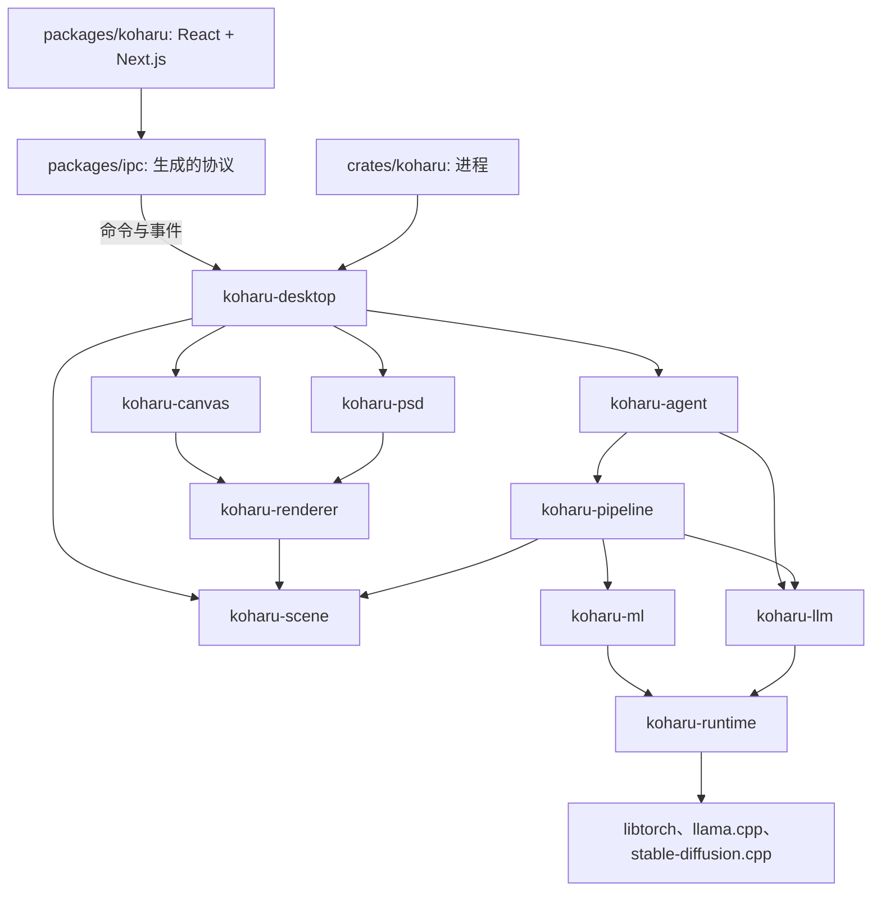

Koharu 以桌面应用运行。React 调用带类型的 Tauri 命令；持久的项目状态、处理和绘制由原生组件负责。

## 界面与应用

| 组件              | 职责                                                                                         |
| ----------------- | -------------------------------------------------------------------------------------------- |
| `packages/koharu` | 开始界面、页面列表、处理选择器、图层、故事、排版工具条、历史记录、智能体面板、设置和活动中心 |
| `packages/ui`     | 共享的 React 基础组件与样式                                                                  |
| `packages/ipc`    | 由桌面端命令和事件生成的 TypeScript 协议                                                     |
| `crates/koharu`   | 进程：崩溃报告、日志、panic 处理和应用的启动顺序                                             |
| `koharu-desktop`  | 窗口、命令、项目文件夹、导入与导出、设置以及 MCP 服务器                                      |
| `koharu-sentry`   | 把界面与原生端作为同一个应用接入 Sentry                                                      |

界面在 CEF 中离屏渲染，窗口把它合成在绘制页面的原生画布之上。界面通过场景的查询与编辑读写打开的项目，与智能体和 MCP 客户端使用同一套协议。无论由谁修改，每次变更都会通知窗口，因此画布和面板无需轮询即可重绘。设置是 `config.toml` 中的各个部分，保存时交给各自所属的组件。

<Note>
  `packages/ipc/src/protocol.ts` 由 Rust 签名生成。请修改 Rust
  源码并[重新生成绑定](/zh/development/setup)。
</Note>

## 场景与处理

`koharu-scene` 负责项目文件、页面与图层、编辑和撤销历史。

`koharu-pipeline` 对页面、文本块或涂抹的区域运行检测、OCR、修补和翻译，并负责调度、模型驻留和停止。`koharu-ml` 负责视觉模型，`koharu-llm` 负责本地和托管语言模型以及服务商登录。`koharu-agent` 负责智能体，以及智能体与 MCP 客户端共用的工具。

## 绘制

`koharu-renderer` 使用 vello 在 GPU 上绘制页面：排布文字、合成图层并生成像素。画布、PNG 与 PSD 导出和缩略图都通过它绘制，因此所有输出都与编辑器显示一致。`koharu-canvas` 负责相机、命中测试、选择和工具手势，并返回由桌面端应用的编辑。`koharu-psd` 把页面写成分层 Photoshop 文档。

## 原生运行时边界

安全封装 `koharu-torch`、`koharu-llama` 和 `koharu-diffusion` 与声明 libtorch、llama.cpp、stable-diffusion.cpp C API 的 `-sys` crate 分离。`koharu-bindgen` 生成这些声明，使它们在运行时打开库时解析。`koharu-runtime` 选择 GPU、下载并打开这些库，并获取模型文件。

有两个 crate 被图中多处使用，因此未画出：`koharu-config` 负责 `config.toml` 的类型化配置段和加密的密钥数据，其密钥保存在操作系统凭据存储中；`koharu-leptonica` 移植了 `koharu-ml` 用来测量文字的 Leptonica 算法。

<CardGroup cols={2}>
  <Card title="场景与存储" icon="database" href="/zh/development/scene">
    了解图层、编辑、历史与项目文件。
  </Card>

  <Card title="处理与渲染" icon="layer-group" href="/zh/development/rendering">
    跟随处理任务经过渲染器到达窗口。
  </Card>
</CardGroup>
