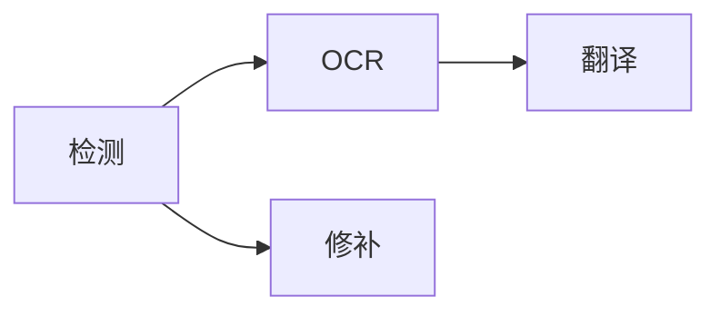

## 调度任务

`koharu-pipeline` 接收请求：一个目标、一组阶段，以及可选的仅用于本次运行的设置。

| 目标               | 阶段                            |
| ------------------ | ------------------------------- |
| 整个项目或部分页面 | 检测、OCR、修补、翻译中的任意项 |
| 部分文本块         | OCR、修补、翻译                 |
| 涂抹的区域         | 修补                            |

一次任务是由各页面阶段组成的图：页面的检测先于其他阶段，OCR 先于翻译；翻译是按页面顺序进行的同一段对话，因此每页的翻译先于下一页。阶段不会启动其他阶段，无事可做的阶段会直接成功。针对文本块或区域的任务优先，其后按到达顺序处理针对页面的任务。最多同时处理三页：一页读取输入，一页在模型上运行，一页写入结果。

每个阶段把某一页的结果写成一个以阶段名为标签的撤销步骤。第一个失败会结束该任务，并指出页面、阶段和原因；已完成的部分会保留。

## 管理驻留与停止

模型在阶段首次需要时，于唯一拥有模型的线程上加载，并在该线程上一次只运行一个调用，因此峰值内存为所有已加载模型加上最大的工作集。本地语言模型在旁边的独立线程上解码。不会为了腾出空间而卸载模型：放不下的模型会失败并指出可用内存。设置切换到其他模型或处理流程结束时，模型才会卸载。

停止会结束所有正在运行和排队的任务。已停止的任务不会再写入任何内容。

## 准备帧

`koharu-renderer` 把打开会话中的页面转换为不可变的帧，并用 vello 在 GPU 上绘制。图层内容按其依赖（如文字和字体）缓存，因此编辑后的渲染会复用所有未受影响的图层。视图只绘制所需的区域和细节层级。

文字大小、换行和位置在每次渲染时于此处计算，别处不保存，因此不会留下过期的结果。页面每边最多 32,768 像素，总计最多 268,435,456 像素。

<Note>
  画布、PNG 与 PSD 导出和缩略图在同一块 GPU 上通过同一个绘制器绘制，因此所有输出都与编辑器显示一致。
</Note>

## 在窗口中显示

窗口在自己的表面上绘制三层：原生画布，其上是 React 界面，再上是界面打开的弹出层，例如展开的 `<select>`。CEF 离屏渲染界面，在 GPU 支持时以 GPU 纹理交付每次绘制，否则通过内存复制。页面在界面透明的地方显示出来。

在界面没有绘制内容的地方，指针事件交给画布，其他地方交给界面；键盘输入（包括输入法组字）交给界面。`koharu-canvas` 把指针转换为手势，在叠加层中预览，并返回由桌面端像处理其他写入者一样应用的编辑。

## 检查桌面端效果

调试构建会在独立的浏览器配置文件中，于 `http://127.0.0.1:4000` 提供 CEF 的 DevTools 协议，用于检查和操作界面。CDP 截图只包含界面，因此要截取包含画布的合成窗口，请使用调试构建的 `capture` 命令。
