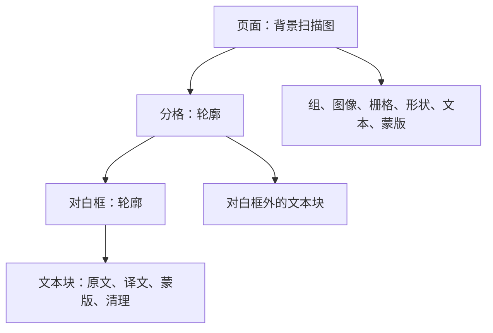

`koharu-scene` 负责定义项目的含义以及项目如何存储。

## 图层与漫画专用类型

项目包含有序的页面。每个页面有一个背景（导入的扫描图）和一棵图层树。普通图层沿用 Photoshop：组、图像、栅格、形状、文本和蒙版。另有三种类型沿用 CLIP STUDIO PAINT 的分格与对白框，承载漫画页面的组成部分：

文本块是页面上的一段文字。原文不会绘制，绘制的是译文。蒙版覆盖原文字形，清理是只在蒙版内、显示在译文下方的栅格。处理流程的每个阶段只写入文本块中属于自己的字段，因此为某个阶段换用新模型时，写入的仍是相同字段。带命名空间的属性为工具保存数据，例如模型操作的 C2PA 记录；渲染器从不读取属性。

## 应用编辑

编辑器、处理任务和智能体都以同一种方式编辑项目。一次编辑带有撤销标签和变更内容，要么整体生效，要么完全不生效。图层补丁是 JSON Merge Patch，会被读回图层的类型，因此拼错的属性或形状不对的值会失败，图层保持原样。

<Note>
  无论模型还是用户，最后写入的值生效。重跑会替换你的修改，撤销可以回退。哪个阶段写哪些字段由工作流决定，场景本身不做限制。
</Note>

## 存储项目

项目是一个扩展名为 `.khr` 的 SQLite 文件，包含页面图像。每次编辑在应用时即保存，因此没有保存操作，也不存在未保存状态。栅格像素按 64×64 图块分别压缩存储，只存储含有像素的图块。打开的项目会被独占锁定，第二个写入者会立即发现它已被锁定。

## 历史

历史按从旧到新列出每一步的标签，可以回到或前进到任意一步。它保留最近 20 步，只在项目打开期间存在，就像关闭 Photoshop 文档会清除其历史状态一样。

## 打开与版本

打开采用失败即拒绝的方式：形状不对的值、未知类型、缺失的像素或不是项目的文件都无法打开，文件保持原样。项目的 `version` 是 SemVer 版本，只在核心结构变化时改变。读取器可以打开同一主版本内不高于自身的任意版本；更新的版本无法打开。

## 保持应用职责分离

桌面端负责项目文件夹和项目名称。渲染器、处理流程和智能体读取打开的会话并提交编辑，不会直接写入文件。
