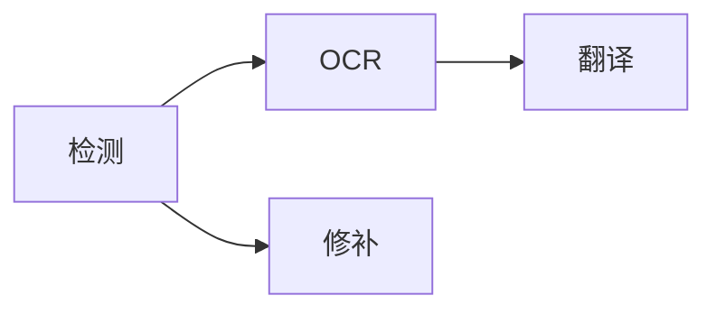

画布上方的处理选择器用于设置模型、页面范围、阶段和目标语言。从能覆盖任务的最小范围开始。

## 选择范围

<Tabs>
  <Tab title='所选页面'>处理页面列表中选择的页面。</Tab>
  <Tab title='整个项目'>按项目顺序处理全部页面。</Tab>
  <Tab title='单个文本'>
    在**故事**中把指针移到文本块上或选中它，再点击编号下方的翻译按钮。它只翻译这一个文本块。
  </Tab>
</Tabs>

## 选择阶段

选择至少一个阶段，再点击**运行**。所选阶段始终按以下顺序进行：

检测会找出分格、对白框和文本块，并为每个文本块生成覆盖原文字形的蒙版。OCR 读取每个文本块的原文。修补重建每个蒙版下方的图稿。翻译写入每个文本块的译文，并把它放进对白框中属于该文本块的区域；没有对白框时放进原文的文本框。

<Note>省略的阶段不会自动补上。后续阶段需要新输入时，请同时选择检测或 OCR。</Note>

## 查看进度与停止

活动中心显示每个任务的阶段、页面、进度与错误。在其他任务运行时启动的任务会排队等待；针对文本块或涂抹区域的任务优先。**停止**会结束所有正在运行和排队的任务。

每个阶段完成后立即把每页的结果写成一个撤销步骤。后续阶段失败或任务停止时，已完成的结果会保留。第一个失败会结束该任务，并指出页面、阶段和原因。

无事可做的阶段（例如对没有文字的页面运行 OCR）什么也不做，也不算失败。

<Warning>
  重跑会替换现有内容，包括你自己的编辑，撤销可以回退。检测会替换页面的分格、对白框和文本块，但会保留已锁定的部分。OCR
  会重写原文，翻译会重写每段译文的文字与位置。
</Warning>

继续[检查文字](/zh/guides/review)或[清理原文](/zh/guides/cleanup)。
