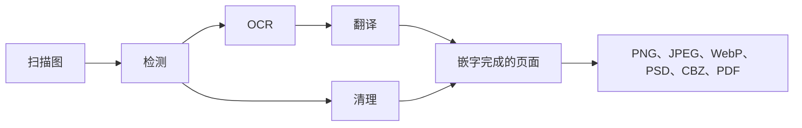

Koharu 用四个阶段把扫描图变成嵌字完成的页面。每个阶段写入的都是普通的项目数据：可以选择、编辑、隐藏和撤销的图层。结果不是一张成品图，而是你继续加工的起点。

## 各阶段写入的内容

<Steps>
  <Step title='检测'>
    **Koharu Layout HighRes**
    读取扫描图，按阅读顺序写入页面的分格、对白框和文本块，每个文本块带有框、倾斜、方向和蒙版。参见[检测与
    OCR](/zh/how-it-works/detection)。
  </Step>
  <Step title='OCR'>
    **Hayai OCR** 读取每个文本块框内的扫描图，写入文本块的原文。参见
    [OCR](/zh/how-it-works/detection#ocr)。
  </Step>
  <Step title='清理'>
    **修补**阶段（默认使用
    **LaMa**）读取扫描图以及每个文本块的蒙版、对白框和分格，写入每个文本块透过蒙版显示的清理结果。参见[清理](/zh/how-it-works/cleanup)。
  </Step>
  <Step title='翻译'>
    **Index-Translate 9B**
    按阅读顺序读取页面的原文，开启**视觉**时还会读取扫描图，写入每个文本块的译文及其位置。参见[翻译](/zh/how-it-works/translation)。
  </Step>
</Steps>

没有单独的排版阶段。翻译在写出译文的同时放置它，渲染器在每次绘制页面时把译文排入框中。参见[译文的排入](/zh/how-it-works/lettering)。

## 每次任务都遵循的规则

- **任务只做被要求的事。** 它在你指定的页面或文字上运行你选择的阶段。它不会判断某页无需处理，也不会因为读取的内容变了而重新运行：修正原文后，该文字的译文会保持原样，直到你重新翻译它。
- **一个阶段不会调用另一个阶段。** 不经检测的 OCR 读取的是已有的文本块。无事可做的阶段（例如对没有文字的页面运行 OCR）什么也不做，也不算失败。
- **重新运行会替换。** 模型的结果会覆盖已有内容，包括你自己的编辑，撤销是回退的方法。锁定是例外：任何阶段都不会写入锁定的文本块，或位于锁定图层内的文本块。
- **每页的每个阶段是一个撤销步骤**，完成即写入，因此停止或失败的任务会保留已完成的部分。
- **失败属于某一页，或属于整个任务。** 被翻译模型拦截或得不到回答的页面会保持未翻译，任务继续。其他失败在下一页也会发生，因此会结束整个任务，并指出页面、阶段和原因。
- **不会自行运行。** 只有在你选择**运行**、从页面或文字的菜单运行某个阶段、松开**移除**笔画、选择**生成**或请 Agent 处理时，模型才会运行。

## 在哪里运行

检测、OCR、清理以及 Koharu 自带的翻译模型都在你的 GPU 上运行，页面也在 GPU 上绘制。你连接的托管服务商会收到翻译或 Agent 发送的内容：每页的文字，以及开启**视觉**时的页面图像。参见[在 GPU 上运行的模型](/zh/how-it-works/runtime)。

## 本节页面

<Columns cols={2}>
  <Card title='页面、图层与历史记录' icon='layers' href='/zh/how-it-works/projects'>
    项目保存什么，文本块如何把四个部分放在一起，编辑与撤销如何运作。
  </Card>
  <Card title='检测与 OCR' icon='search' href='/zh/how-it-works/detection'>
    Koharu 如何找到文字、排定阅读顺序、测量并读取文字。
  </Card>
  <Card title='清理' icon='eraser' href='/zh/how-it-works/cleanup'>
    为什么大多数文字不用模型就能填充，以及模型如何重绘其余部分。
  </Card>
  <Card title='翻译' icon='languages' href='/zh/how-it-works/translation'>
    每个项目一段对话、模型收到什么，以及何时重新请求某页。
  </Card>
  <Card title='译文的排入' icon='a-large-small' href='/zh/how-it-works/lettering'>
    译文放在哪里、字号多大、颜色从何而来。
  </Card>
  <Card title='页面的绘制' icon='pen-tool' href='/zh/how-it-works/rendering'>
    画布与所有导出共用的渲染器、竖排、注音和字体。
  </Card>
  <Card title='在 GPU 上运行的模型' icon='cpu' href='/zh/how-it-works/runtime'>
    哪块 GPU 运行模型、会下载什么、模型如何共享内存与任务。
  </Card>
</Columns>

<Note>
  这些页面解释你在应用中看到的行为。各部分的设计及其测量结果和出处，在每页末尾链接的所属 crate 的
  README 中。
</Note>

设计与出处：[`koharu-pipeline` 的 README](https://github.com/koharu-rs/koharu/blob/main/crates/koharu-pipeline/README.md)。
